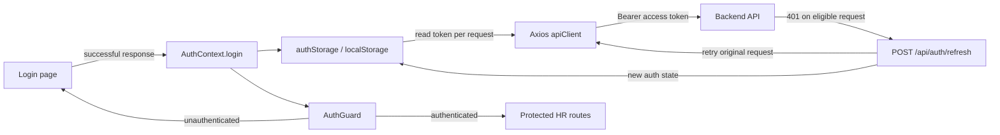

This page explains how the React frontend persists authentication, attaches credentials to API calls, handles expired sessions, and turns endpoint-specific modules into typed request helpers. The central pattern is a shared Axios client with token injection and response handling, surrounded by an authentication context for UI state. It covers frontend behavior only; backend authorization rules and endpoint contracts are documented separately in [Authentication, Authorization, and Candidate Access](9-authentication-authorization-and-candidate-access) and [API Contracts, Validation, and Error Handling](8-api-contracts-validation-and-error-handling). Sources: [client.ts](frontend/src/api/client.ts#L10-L107), [auth.ts](frontend/src/lib/auth.ts#L9-L64), [AuthContext.tsx](frontend/src/contexts/AuthContext.tsx#L23-L75)

## Architectural model

The frontend separates **credential persistence**, **in-memory UI state**, **request transport**, and **route gating**. `authStorage` is the browser-storage boundary; `AuthProvider` exposes user-oriented state to React; `apiClient` applies credentials and normalizes some failures; and `AuthGuard` decides whether protected HR routes may render. This distinction matters: a UI state change does not itself send a request, while API calls read the latest persisted token when the request interceptor runs. Sources: [auth.ts](frontend/src/lib/auth.ts#L25-L64), [AuthContext.tsx](frontend/src/contexts/AuthContext.tsx#L33-L75), [client.ts](frontend/src/api/client.ts#L32-L49), [AuthGuard.tsx](frontend/src/components/AuthGuard.tsx#L17-L35)

The diagram shows the principal frontend paths: successful login writes an `AuthState`, API requests read the stored access token, and the guard uses context state for navigation. The refresh branch is implemented in the Axios response interceptor rather than in the context. Sources: [LoginPage.tsx](frontend/src/pages/LoginPage.tsx#L26-L72), [client.ts](frontend/src/api/client.ts#L42-L85), [AuthContext.tsx](frontend/src/contexts/AuthContext.tsx#L33-L62), [AuthGuard.tsx](frontend/src/components/AuthGuard.tsx#L17-L35)

## Authentication state: storage and React context

`AuthState` contains `access_token`, `refresh_token`, `token_type`, and a `user` object with identity fields. `authStorage` serializes the complete state under the `interview_auth` localStorage key. Its `get()` method returns `null` when running without `window`, when the key is absent, or when stored JSON cannot be parsed; `set()` writes the serialized state, and `clear()` removes it. The helper also exposes authentication and current-user convenience methods. Sources: [auth.ts](frontend/src/lib/auth.ts#L9-L64)

`AuthProvider` initializes with `user = null` and `loading = true`, then reads the saved state in an effect, updates the user, and marks initialization complete. Its `login()` method persists the supplied state and updates the React user; `logout()` clears storage and sets the user to `null`. The context’s `isAuthenticated` value is derived from `user !== null`, rather than from a separate token-expiry check. Components use `useAuth()`, which throws if rendered outside the provider. Sources: [AuthContext.tsx](frontend/src/contexts/AuthContext.tsx#L23-L75)

| Concern | Implementation | Observable behavior |
|---|---|---|
| Persistence | `authStorage` stores JSON at `interview_auth` | State can be recovered from localStorage on provider initialization. |
| UI identity | `AuthProvider` stores `UserInfo \| null` in React state | Consumers receive `user`, `isAuthenticated`, and `loading`. |
| Login transition | `login(state)` persists the state and sets the user | The UI becomes authenticated after the login page invokes it. |
| Logout transition | `logout()` removes stored state and clears the user | Context consumers observe an unauthenticated state. |
| Token renewal | Response interceptor calls `authStorage.set(newAuth)` | The stored credentials are replaced; the shown interceptor does not directly update `AuthProvider` state. |

Sources: [auth.ts](frontend/src/lib/auth.ts#L25-L64), [AuthContext.tsx](frontend/src/contexts/AuthContext.tsx#L33-L62), [client.ts](frontend/src/api/client.ts#L57-L83)

**Implementation detail:** the refresh handler replaces the persisted auth object but does not call a context method. Since the context stores the user separately, token renewal and UI identity are not coupled through an explicit context update. This is a boundary to keep in mind when modifying auth state: any change that must update React consumers should be wired through context or another shared state mechanism, rather than assuming a localStorage write triggers a React render. Sources: [client.ts](frontend/src/api/client.ts#L63-L80), [AuthContext.tsx](frontend/src/contexts/AuthContext.tsx#L33-L62)

## Shared API client and request pipeline

`apiClient` is an Axios instance configured with `VITE_API_BASE_URL` (or an empty string), a 30-second timeout, and a default JSON content type. Its request interceptor reads `authStorage` for each request and, when an access token exists, sets `Authorization: Bearer <access_token>`. This keeps endpoint helpers focused on paths, parameters, payloads, and result types instead of duplicating token attachment. Sources: [client.ts](frontend/src/api/client.ts#L32-L49)

The client’s response interceptor passes successful responses through unchanged. For a 401 response, it attempts refresh only when the request has not already been retried and its URL does not contain `/api/auth/`. If a refresh token is present, it posts to `/api/auth/refresh` with the refresh token as a query parameter, saves `resp.data.data`, replaces the original request’s authorization header, and retries that request through `apiClient`. The `_retry` marker prevents the same original request from entering an unbounded refresh-and-retry loop. Sources: [client.ts](frontend/src/api/client.ts#L51-L85)

The refresh call uses `axios.post` directly, rather than `apiClient.post`, so it does not pass through this client’s request and response interceptors. The code also invokes that refresh URL as a relative path and does not apply the original request’s configured `baseURL` explicitly. These are concrete differences in the refresh transport path; deployments should verify that the relative URL resolves as intended. Sources: [client.ts](frontend/src/api/client.ts#L34-L40), [client.ts](frontend/src/api/client.ts#L57-L77)

## Refresh failure and error normalization

If refresh fails, the interceptor clears persisted authentication and assigns `/login` to `window.location.href`. If no refresh token is available, the refresh attempt is skipped; processing then continues to the ordinary error handling path. The interceptor does not show a shared refresh promise or queue, so concurrent 401 responses are handled by their individual interceptor executions. Sources: [client.ts](frontend/src/api/client.ts#L57-L85)

`ApiError` carries a numeric `code`, a message, and optional `data`. Its `isRetryable` getter returns `true` for application codes `4001` and `4002` (commented as unauthorized and token expired). When an Axios error has response data with a numeric, nonzero `code`, the response interceptor throws an `ApiError` using the response’s `msg` (or a fallback) and `data`. Other failures, including errors without a matching response body, are rejected as the original error. `isApiError()` provides an `instanceof` type guard. Sources: [client.ts](frontend/src/api/client.ts#L14-L30), [client.ts](frontend/src/api/client.ts#L87-L107)

| Failure condition | Client behavior |
|---|---|
| Successful HTTP response | Returns the response unchanged. |
| HTTP 401; eligible URL; not retried; refresh token exists | Requests refresh, stores returned auth data, and retries the original request. |
| Refresh request fails | Clears stored auth and navigates to `/login`. |
| Response body has numeric, nonzero `code` | Throws `ApiError` with the server message and data. |
| No matching API error body | Rejects the original error. |

Sources: [client.ts](frontend/src/api/client.ts#L51-L98)

## Route protection and login handoff

`AuthGuard` waits for context initialization: while `loading` is true it renders a full-screen spinner. Once loading finishes, unauthenticated users are redirected to `/login` with the current pathname URL-encoded as a `redirect` query parameter; authenticated users see the protected children. The route configuration applies this guard around the HR application layout, while `/login` and `/candidate-portal` are declared outside that protected branch. Sources: [AuthGuard.tsx](frontend/src/components/AuthGuard.tsx#L17-L35), [routes.tsx](frontend/src/routes.tsx#L18-L44)

`LoginPage` posts username and password to `/api/auth/login` through `apiClient`, passes the response’s `data` payload to `login()`, and navigates to the requested redirect or `/dashboard`. It handles `ApiError` codes `4004` and `4001` as invalid credentials, displays other API messages when available, and reports non-`ApiError` failures as network errors. Sources: [LoginPage.tsx](frontend/src/pages/LoginPage.tsx#L41-L72)

## Endpoint modules and request conventions

Feature-specific modules import the shared client and expose typed methods that generally unwrap the backend envelope by returning `data.data`. For example, candidate and interview methods define request/response interfaces and centralize their paths, query parameters, and HTTP verbs. This pattern keeps transport and auth behavior in `client.ts`, while domain-specific request construction stays alongside each feature’s API module. Sources: [candidates.ts](frontend/src/api/candidates.ts#L1-L5), [candidates.ts](frontend/src/api/candidates.ts#L43-L92), [interviews.ts](frontend/src/api/interviews.ts#L60-L94)

JSON requests use the shared default content type. Upload methods construct `FormData` and pass a multipart content-type header; candidate resume upload and candidate audio-answer submission both follow this pattern. Candidate portal methods receive the portal token as part of their URL path, rather than relying on the HR access token as their explicit endpoint credential. Sources: [client.ts](frontend/src/api/client.ts#L34-L40), [candidates.ts](frontend/src/api/candidates.ts#L54-L75), [candidatePortal.ts](frontend/src/api/candidatePortal.ts#L29-L73)

A few helpers return a URL string instead of using Axios: `candidatesApi.resumeUrl()` and `interviewsApi.reportUrl()` construct API paths for callers. Such URL helpers do not themselves apply the Axios request interceptor, so consumers should not assume they receive the shared client’s bearer-header behavior. Sources: [candidates.ts](frontend/src/api/candidates.ts#L108-L112), [interviews.ts](frontend/src/api/interviews.ts#L87-L94)

## Practical boundaries

The code explicitly documents localStorage-backed JWT state as an MVP choice and notes its exposure to theft through XSS, with HttpOnly cookies mentioned as a possible later alternative. This is an implementation-level security consideration, not a claim that the current frontend mitigates XSS. Sources: [auth.ts](frontend/src/lib/auth.ts#L1-L8)

For changes to the client, preserve the separation between shared transport policy and feature-specific request methods. When changing login or refresh behavior, check both persistence and React context behavior; when changing API error handling, check consumers that distinguish `ApiError` from other thrown errors. Continue with [TanStack Query, Forms, and Client-Side Validation](24-tanstack-query-forms-and-client-side-validation) for data-fetching and form patterns, or [SSE Subscription and Typed Event Handling](26-sse-subscription-and-typed-event-handling) for the separate real-time transport path. Sources: [client.ts](frontend/src/api/client.ts#L14-L107), [AuthContext.tsx](frontend/src/contexts/AuthContext.tsx#L23-L75), [LoginPage.tsx](frontend/src/pages/LoginPage.tsx#L53-L71)