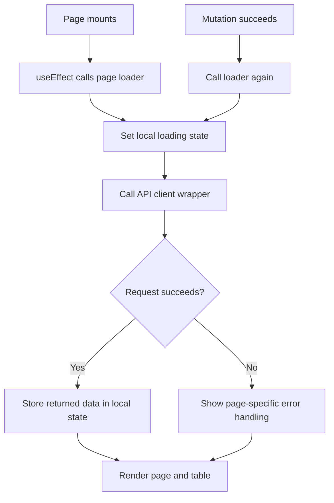

This page explains how the frontend handles server data and form input, and—just as importantly—where the implementation does **not** use the libraries its dependencies make available. The repository includes TanStack Query, React Hook Form, Zod, and the resolver that connects Zod to React Hook Form. In the examined pages, however, server data is loaded with component effects and local state; form handling varies between a schema-backed React Hook Form example and manually controlled inputs. Sources: [package.json](frontend/package.json#L13-L50), [PositionsPage.tsx](frontend/src/pages/PositionsPage.tsx#L6-L37), [CandidatesPage.tsx](frontend/src/pages/CandidatesPage.tsx#L4-L41)

## How server data is currently managed

**TanStack Query is installed, but the examined pages do not use it.** Positions, candidates, interviews, and dashboard data are fetched in page-level asynchronous functions, usually invoked once from `useEffect`. The results and loading flags are stored with `useState`; failures are handled locally, with toast notifications in the management pages and console logging on the dashboard. Sources: [package.json](frontend/package.json#L32-L45), [PositionsPage.tsx](frontend/src/pages/PositionsPage.tsx#L28-L53), [CandidatesPage.tsx](frontend/src/pages/CandidatesPage.tsx#L27-L61), [InterviewsPage.tsx](frontend/src/pages/InterviewsPage.tsx#L23-L56), [DashboardPage.tsx](frontend/src/pages/DashboardPage.tsx#L23-L54)

The pages also coordinate related reads directly. Candidates loads candidates and positions with `Promise.all`; interviews loads interviews, candidates, and positions together; the dashboard loads positions, candidates, and interviews together to calculate KPIs. This makes each page’s loading sequence visible, but the shown code does not provide a shared query cache or a common data-loading abstraction. Sources: [CandidatesPage.tsx](frontend/src/pages/CandidatesPage.tsx#L43-L60), [InterviewsPage.tsx](frontend/src/pages/InterviewsPage.tsx#L36-L56), [DashboardPage.tsx](frontend/src/pages/DashboardPage.tsx#L29-L54)

The diagram describes the observed page-level pattern: mutations such as position creation, update, or deletion and candidate upload are followed by a call to the page’s loader. This refresh is explicit rather than an observed cache invalidation operation. Sources: [PositionsPage.tsx](frontend/src/pages/PositionsPage.tsx#L74-L103), [CandidatesPage.tsx](frontend/src/pages/CandidatesPage.tsx#L63-L85)

## Forms and validation patterns

The Positions page is the clearest example of schema-driven form validation. It defines a Zod object schema, including a required non-empty name, defaults for optional text fields, integer coercion and a minimum for quantity, and an integer status constrained to the range 0–2. `zodResolver(positionSchema)` connects that schema to `useForm`; the form registers fields, reads validation errors, and sends valid submissions to `onSubmit`. Sources: [PositionsPage.tsx](frontend/src/pages/PositionsPage.tsx#L17-L37), [PositionsPage.tsx](frontend/src/pages/PositionsPage.tsx#L163-L201)

Create and edit share the same form. `openCreate` clears the editing record and resets fields to blank/default values; `openEdit` stores the selected position and resets the form from its values. On submit, the handler calls the create or update API depending on whether a record is being edited, then closes the form and reloads the list. Sources: [PositionsPage.tsx](frontend/src/pages/PositionsPage.tsx#L55-L92)

| Form pattern | Observed implementation | Validation and state behavior |
|---|---|---|
| Position create/edit | React Hook Form with Zod resolver | Schema checks name, coerces and bounds numeric values, and supplies defaults; field errors are rendered for the name. |
| Candidate upload | Controlled React state | A manual guard checks that name, email, position, and file are present; the email input declares `type="email"`, and the file input accepts `.pdf` and `.docx`. |
| Interview creation | Controlled React state | A manual guard requires candidate and position; the interviewer is optional and sent as `undefined` when blank. |
| Login | Controlled React state | A manual guard checks username and password are non-empty before the request. |

Sources: [PositionsPage.tsx](frontend/src/pages/PositionsPage.tsx#L17-L37), [PositionsPage.tsx](frontend/src/pages/PositionsPage.tsx#L163-L201), [CandidatesPage.tsx](frontend/src/pages/CandidatesPage.tsx#L36-L41), [CandidatesPage.tsx](frontend/src/pages/CandidatesPage.tsx#L63-L85), [CandidatesPage.tsx](frontend/src/pages/CandidatesPage.tsx#L202-L253), [InterviewsPage.tsx](frontend/src/pages/InterviewsPage.tsx#L31-L34), [InterviewsPage.tsx](frontend/src/pages/InterviewsPage.tsx#L58-L83), [LoginPage.tsx](frontend/src/pages/LoginPage.tsx#L26-L49)

The contrast is significant: the Position form has a reusable, declarative schema and field-level error rendering, while the other examined forms validate through explicit conditionals and page-local state. The candidate upload guard checks for presence, not an application-level email format or file-content validation in the shown component. Browser input attributes and client-side checks improve interaction, but the code shown does not replace server-side validation. Sources: [PositionsPage.tsx](frontend/src/pages/PositionsPage.tsx#L17-L37), [PositionsPage.tsx](frontend/src/pages/PositionsPage.tsx#L163-L168), [CandidatesPage.tsx](frontend/src/pages/CandidatesPage.tsx#L63-L85), [CandidatesPage.tsx](frontend/src/pages/CandidatesPage.tsx#L207-L237)

## Submission, feedback, and refresh behavior

Position submission converts validated form values into the API payload, calls create or update, shows a success toast, closes the form, and reloads the list. Failures show a generic “save failed” toast. Candidate upload similarly disables the upload action while a request is in progress, clears form state after success, and distinguishes `ApiError` from other errors when choosing its message. Sources: [PositionsPage.tsx](frontend/src/pages/PositionsPage.tsx#L74-L92), [CandidatesPage.tsx](frontend/src/pages/CandidatesPage.tsx#L63-L85), [CandidatesPage.tsx](frontend/src/pages/CandidatesPage.tsx#L246-L253)

The interview creation flow also guards against missing selections, marks the operation as creating, submits the selected IDs and optional interviewer, and reloads after success. The login page tracks its own loading state, prevents the browser’s default form submission, checks required fields, and displays request errors through toasts. These are local component workflows; they are not shown as TanStack Query mutations. Sources: [InterviewsPage.tsx](frontend/src/pages/InterviewsPage.tsx#L58-L83), [LoginPage.tsx](frontend/src/pages/LoginPage.tsx#L26-L73)

## Reading the implementation accurately

The dependency list proves that TanStack Query, React Hook Form, Zod, and `@hookform/resolvers` are available to the frontend. It does **not** prove that TanStack Query is configured or used by the pages described here. The examined application entry wraps the router in the project’s `App`, whose providers include an error boundary, authentication provider, and toaster; that provider tree does not show a `QueryClientProvider`. Sources: [package.json](frontend/package.json#L13-L50), [main.tsx](frontend/src/main.tsx#L1-L15), [App.tsx](frontend/src/App.tsx#L9-L24)

For a representative API boundary, the positions API module defines TypeScript request and response types and wraps calls through `apiClient`. The page awaits those wrapper methods and manages returned data itself. This separation keeps endpoint calls out of the component’s request details, while loading state and refresh behavior remain page-owned in the example examined. Sources: [positions.ts](frontend/src/api/positions.ts#L6-L36), [positions.ts](frontend/src/api/positions.ts#L45-L70), [PositionsPage.tsx](frontend/src/pages/PositionsPage.tsx#L39-L53)

## Practical implications

When maintaining the current patterns, keep page loading, request errors, pending states, and post-mutation refreshes consistent with the surrounding page. For schema-backed forms, update the Zod schema and the rendered field feedback together; for controlled forms, ensure the manual guard corresponds to the actual payload and that pending state is reset on both success and failure. The repository evidence supports these as implementation-specific maintenance concerns; it does not establish a project-wide TanStack Query convention. Sources: [PositionsPage.tsx](frontend/src/pages/PositionsPage.tsx#L17-L37), [PositionsPage.tsx](frontend/src/pages/PositionsPage.tsx#L74-L92), [CandidatesPage.tsx](frontend/src/pages/CandidatesPage.tsx#L63-L85), [InterviewsPage.tsx](frontend/src/pages/InterviewsPage.tsx#L58-L83)

For adjacent frontend context, continue with [API Client, Authentication State, and Request Handling](23-api-client-authentication-state-and-request-handling), then [Candidate Portal, Audio Capture, and Interview Experience](25-candidate-portal-audio-capture-and-interview-experience). Sources: [positions.ts](frontend/src/api/positions.ts#L45-L70), [CandidatesPage.tsx](frontend/src/pages/CandidatesPage.tsx#L63-L85)