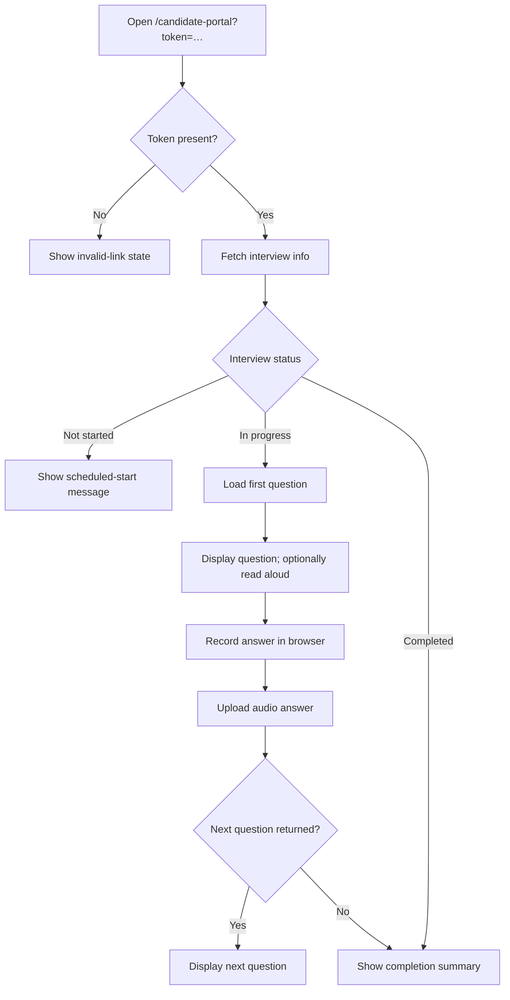

This page explains the public candidate interview flow: a tokenized portal loads interview details and questions, reads questions aloud in the browser when enabled, captures spoken answers, and advances through the interview. It focuses on the frontend experience and its portal API interaction; broader routing, authentication, transcription, and workflow internals are covered in [React Application Entry, Routing, and Page Responsibilities](22-react-application-entry-routing-and-page-responsibilities), [Authentication, Authorization, and Candidate Access](9-authentication-authorization-and-candidate-access), and [Speech Recording, FFmpeg, and Whisper Transcription](15-speech-recording-ffmpeg-and-whisper-transcription). Sources: [CandidatePortalPage.tsx](frontend/src/pages/CandidatePortalPage.tsx#L1-L38)

## Portal interaction model

The portal is a public route that reads a `token` query parameter; it does not sit inside the HR application’s authenticated layout. The page uses that token for its candidate portal API calls. Its user-facing states are loading, invalid/error, not started, active interview, and completed. Sources: [routes.tsx](frontend/src/routes.tsx#L15-L25) [CandidatePortalPage.tsx](frontend/src/pages/CandidatePortalPage.tsx#L24-L45)

This describes the client flow: `getInfo` supplies interview metadata and initial progress, then the page requests the first question for an active interview. On answer submission, the API response carries both the updated answered count and the next question, allowing the UI to advance without a separate next-question request. Sources: [CandidatePortalPage.tsx](frontend/src/pages/CandidatePortalPage.tsx#L40-L105) [CandidatePortalPage.tsx](frontend/src/pages/CandidatePortalPage.tsx#L107-L139) [candidatePortal.ts](frontend/src/api/candidatePortal.ts#L24-L68)

## Interview page states and progress

The page initializes in `loading`. Missing tokens and failed info requests lead to `error`; status `0` is treated as `not_started`, status `3` or higher as `completed`, and other statuses enter the active flow. While answering, the page shows position and candidate names, an answered/total count, a proportional progress bar, the current question, and the recording control. Sources: [CandidatePortalPage.tsx](frontend/src/pages/CandidatePortalPage.tsx#L24-L102) [CandidatePortalPage.tsx](frontend/src/pages/CandidatePortalPage.tsx#L180-L226)

| Experience state | Trigger in the page | Candidate-facing result |
|---|---|---|
| Loading | Initial state while interview info is requested | Centered spinner |
| Invalid/error | Missing token or info request failure | Invalid-link message |
| Not started | Interview status is `0` | Scheduled interview time and wait message |
| In progress | Status is below `3` and not `0` | Interview details, progress, current question, and audio controls |
| Completed | Status is `3` or higher, or no next question is returned | Completion confirmation and answered/total count |

Sources: [CandidatePortalPage.tsx](frontend/src/pages/CandidatePortalPage.tsx#L24-L45) [CandidatePortalPage.tsx](frontend/src/pages/CandidatePortalPage.tsx#L62-L105) [CandidatePortalPage.tsx](frontend/src/pages/CandidatePortalPage.tsx#L142-L178)

The page updates the answered count from the submission response and displays a success notification. If the response contains question ID `0`, it clears the current question, marks the interview complete, and shows a completion notification; otherwise, it renders the returned next question. Submission errors are surfaced through a toast, and the submitting flag is reset in `finally`. Sources: [CandidatePortalPage.tsx](frontend/src/pages/CandidatePortalPage.tsx#L107-L139)

## Question reading and voice preference

`QuestionReader` uses the browser’s Speech Synthesis API when available. With `autoPlay` enabled, it speaks when the question text changes and reading is enabled; speech is configured with `zh-CN`, rate `1.0`, and pitch `1.0`. The reader offers a manual speak/stop control and an automatic-reading checkbox. If Speech Synthesis is unavailable, the component renders nothing. Sources: [QuestionReader.tsx](frontend/src/components/QuestionReader.tsx#L14-L41) [QuestionReader.tsx](frontend/src/components/QuestionReader.tsx#L43-L85)

The portal initializes its `voiceReading` state from interview info and passes it to the reader. Toggling updates local state immediately, then attempts to persist the preference through the API; persistence errors are intentionally ignored by the page. The backend preference endpoint updates the interview preference and writes an audit event. Sources: [CandidatePortalPage.tsx](frontend/src/pages/CandidatePortalPage.tsx#L29-L34) [CandidatePortalPage.tsx](frontend/src/pages/CandidatePortalPage.tsx#L141-L151) [candidate_portal.py](backend/app/api/candidate_portal.py#L310-L327)

## Audio capture and submission

`VoiceRecorder` obtains a microphone stream through `navigator.mediaDevices.getUserMedia({ audio: true })`, creates a `MediaRecorder`, and collects non-empty data chunks. It prefers `audio/webm;codecs=opus` when supported, otherwise uses `audio/webm`. Stopping the recorder assembles the chunks into a `Blob` and invokes `onComplete`; the component also stops the stream’s tracks after capture and on unmount. Sources: [VoiceRecorder.tsx](frontend/src/components/VoiceRecorder.tsx#L15-L32) [VoiceRecorder.tsx](frontend/src/components/VoiceRecorder.tsx#L54-L92)

The recording button toggles between start and stop, and a one-second interval displays elapsed time while recording. Permission or setup failures set an inline error and show a toast. The component accepts a `disabled` prop, which the page binds to its submission state; its recording-state hint also uses that prop to show “please listen to the question first,” although the page does not derive `disabled` from speech playback state. Sources: [VoiceRecorder.tsx](frontend/src/components/VoiceRecorder.tsx#L34-L52) [VoiceRecorder.tsx](frontend/src/components/VoiceRecorder.tsx#L94-L143) [CandidatePortalPage.tsx](frontend/src/pages/CandidatePortalPage.tsx#L209-L221)

The API client sends `question_id` and the recorded blob as multipart fields, naming the file `answer.webm`. The backend validates that the question belongs to the token-authorized interview and has not already been answered, stores the audio bytes, records the answer timestamp, increments interview progress, and returns the next question or a completion sentinel. Sources: [candidatePortal.ts](frontend/src/api/candidatePortal.ts#L42-L55) [candidate_portal.py](backend/app/api/candidate_portal.py#L108-L154) [candidate_portal.py](backend/app/api/candidate_portal.py#L288-L307)

## API calls used by the portal

| Client operation | Request | Role in the experience |
|---|---|---|
| `getInfo(token)` | `GET /api/candidate/{token}/info` | Loads interview identity, status, counts, scheduled time, and voice preference |
| `getNextQuestion(token, afterId)` | `GET /api/candidate/{token}/questions/next?after=…` | Fetches the initial question; the page treats ID `0` as completion |
| `submitAnswer(token, questionId, audioBlob)` | `POST /api/candidate/{token}/answers` as multipart form data | Submits the recorded answer and receives progress plus the next question |
| `toggleVoice(token, enabled)` | `PATCH /api/candidate/{token}/preferences` | Persists the automatic voice-reading preference |

Sources: [candidatePortal.ts](frontend/src/api/candidatePortal.ts#L24-L68) [candidate_portal.py](backend/app/api/candidate_portal.py#L40-L105) [candidate_portal.py](backend/app/api/candidate_portal.py#L108-L154) [candidate_portal.py](backend/app/api/candidate_portal.py#L310-L327)

## Implementation boundaries

The portal page coordinates display state, question progression, notifications, and API calls. `QuestionReader` and `VoiceRecorder` isolate browser speech and recording APIs into reusable components, while `candidatePortalApi` centralizes the portal’s HTTP operations. This page’s code comments mention SSE as a future integration point, but the displayed answer flow uses request/response API calls rather than an SSE subscription. Sources: [CandidatePortalPage.tsx](frontend/src/pages/CandidatePortalPage.tsx#L1-L22) [QuestionReader.tsx](frontend/src/components/QuestionReader.tsx#L1-L12) [VoiceRecorder.tsx](frontend/src/components/VoiceRecorder.tsx#L1-L13) [candidatePortal.ts](frontend/src/api/candidatePortal.ts#L1-L6)

For adjacent implementation context, continue with [Speech Recording, FFmpeg, and Whisper Transcription](15-speech-recording-ffmpeg-and-whisper-transcription) for audio processing, or [SSE Subscription and Typed Event Handling](26-sse-subscription-and-typed-event-handling) for real-time event handling. Sources: [candidate_portal.py](backend/app/api/candidate_portal.py#L156-L177) [CandidatePortalPage.tsx](frontend/src/pages/CandidatePortalPage.tsx#L1-L22)