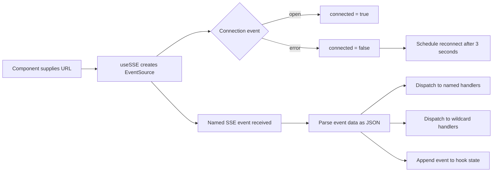

This page explains the frontend’s Server-Sent Events (SSE) subscription hook and the TypeScript event model it exposes. The implementation creates an `EventSource` connection for a supplied URL, dispatches recognized named events to registered callbacks, and records parsed events in hook state. **The runtime hook and the exported event types are separate mechanisms**: the hook’s callback payloads are typed as `any`, while `types/events.ts` defines a discriminated union and a type guard for application code. Sources: [useSSE.ts](frontend/src/hooks/useSSE.ts#L15-L24) [events.ts](frontend/src/types/events.ts#L10-L16)

## Subscription and dispatch model

The hook accepts a URL or `null`. With a URL, it creates an `EventSource`; with `null`, it marks the connection as disconnected and does not open a stream. The hook exposes `connected`, an accumulated `events` array, and `on(eventName, handler)` for registering callbacks. Internally, subscribers are stored in a map from event name to a set of handlers, allowing multiple handlers for the same event name. Sources: [useSSE.ts](frontend/src/hooks/useSSE.ts#L20-L38) [useSSE.ts](frontend/src/hooks/useSSE.ts#L127-L127) [useSSE.ts](frontend/src/hooks/useSSE.ts#L53-L57)

The hook registers listeners for a fixed list of event names. For each received named event, it parses `MessageEvent.data` as JSON, invokes matching handlers, invokes wildcard (`"*"`) handlers with `{ event, data }`, and appends `{ event, data }` to the `events` array. If JSON parsing throws, the catch block ignores the message; it does not dispatch it or add it to state. Sources: [useSSE.ts](frontend/src/hooks/useSSE.ts#L86-L110) [useSSE.ts](frontend/src/hooks/useSSE.ts#L40-L51)

## Connection lifecycle and cleanup

The hook uses the browser’s `EventSource` API with `withCredentials: false`. On `open`, it sets `connected` to `true`. On `error`, it sets `connected` to `false` and schedules a new connection attempt after three seconds, closing the prior `EventSource` before connecting again. Sources: [useSSE.ts](frontend/src/hooks/useSSE.ts#L61-L84)

When the URL-dependent effect is cleaned up, it sets a local stop flag, clears a pending reconnect timer, and closes the current source. The stop flag prevents a scheduled `connect` call from opening a connection after cleanup. The reconnect behavior is implemented by this hook; this description does not imply server-side replay or delivery guarantees. Sources: [useSSE.ts](frontend/src/hooks/useSSE.ts#L59-L69) [useSSE.ts](frontend/src/hooks/useSSE.ts#L116-L125)

## Typed event contract

`events.ts` defines event payload interfaces that share a base `timestamp` field and use a string-literal `event` property to identify each event variant. The exported `InterviewEvent` union combines those interfaces; `SSEEventName` derives the valid event-name union from the `event` fields. This supports narrowing a union value by its event discriminator. Sources: [events.ts](frontend/src/types/events.ts#L10-L16) [events.ts](frontend/src/types/events.ts#L18-L40) [events.ts](frontend/src/types/events.ts#L141-L162)

| Type construct | Role |
|---|---|
| `EventBase` | Common `timestamp: string` field |
| Event interfaces | Describe event-specific discriminator and payload fields |
| `InterviewEvent` | Union of the declared event interfaces |
| `SSEEventName` | Union of the discriminator values |
| `isEventOfType` | Runtime discriminator check with a TypeScript type predicate |

Sources: [events.ts](frontend/src/types/events.ts#L10-L16) [events.ts](frontend/src/types/events.ts#L141-L162) [events.ts](frontend/src/types/events.ts#L184-L191)

The type guard `isEventOfType(event, type)` checks whether `event.event` equals the requested type and narrows the value to the corresponding union member. The file also exports `InterviewStatus` constants and their label mapping; these describe interview status values rather than the SSE subscription mechanism. Sources: [events.ts](frontend/src/types/events.ts#L164-L182) [events.ts](frontend/src/types/events.ts#L184-L191)

## Important boundary: declared types versus runtime handling

The hook’s `on` callback accepts a string event name and a handler whose `data` parameter is `any`; the hook’s `SSEEvent` likewise stores `data: any`. The event interfaces in `events.ts` do not automatically make `useSSE` callbacks type-safe: the hook does not import `InterviewEvent` or `SSEEventName`, and its `knownEvents` list is maintained separately from the event union. Sources: [useSSE.ts](frontend/src/hooks/useSSE.ts#L15-L18) [useSSE.ts](frontend/src/hooks/useSSE.ts#L27-L38) [useSSE.ts](frontend/src/hooks/useSSE.ts#L86-L100) [events.ts](frontend/src/types/events.ts#L141-L162)

There is also a visible coverage difference between the declarations and hook listeners. The type union declares event variants such as `connected`, `interview_created`, `resume_uploaded`, `audio_uploaded`, `transcription_started`, and `transcription_complete`, while the hook’s listener list contains a smaller, different set. Therefore, the union documents available payload shapes, but it should not be read as proof that this hook currently subscribes to every declared event. Sources: [events.ts](frontend/src/types/events.ts#L18-L31) [events.ts](frontend/src/types/events.ts#L39-L91) [useSSE.ts](frontend/src/hooks/useSSE.ts#L86-L100)

## Practical implications for consumers

A consumer can register named or wildcard handlers through `on`; the returned function removes that handler from its event-name set. Registration itself does not return a React effect cleanup automatically, so a component that subscribes inside an effect should use the returned unsubscribe function as that effect’s cleanup. This follows directly from the hook’s subscription API and its returned function. Sources: [useSSE.ts](frontend/src/hooks/useSSE.ts#L27-L38)

For compile-time payload checking, consumers can use the exported event types and `isEventOfType` guard where they already hold an `InterviewEvent`. The current hook API does not connect those types to its callback signature, so payload typing at the subscription boundary remains unverified by TypeScript. Sources: [useSSE.ts](frontend/src/hooks/useSSE.ts#L27-L38) [events.ts](frontend/src/types/events.ts#L141-L162) [events.ts](frontend/src/types/events.ts#L184-L191)

## Next steps

For the server-side event stream and delivery path, continue with [Server-Sent Events and Real-Time Progress Delivery](19-server-sent-events-and-real-time-progress-delivery). For deployment behavior affecting long-lived SSE connections, see [Docker Compose, Nginx, and SSE-Aware Deployment](30-docker-compose-nginx-and-sse-aware-deployment). Sources: [useSSE.ts](frontend/src/hooks/useSSE.ts#L61-L84)