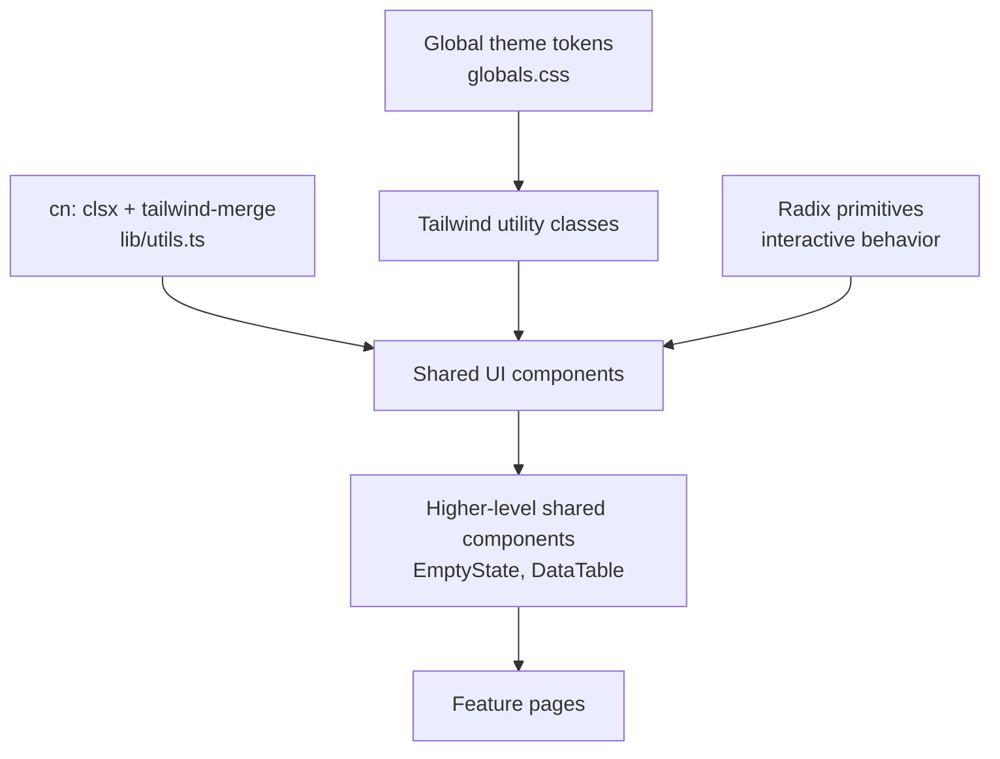

This page explains how the frontend’s shared UI is assembled: design tokens and global styles provide the visual foundation; small utility functions and variant definitions standardize class composition; and reusable components expose consistent controls and display patterns. It focuses on those primitives and shared components, not page-specific flows. Sources: [globals.css](frontend/src/styles/globals.css#L1-L34), [utils.ts](frontend/src/lib/utils.ts#L1-L9), [ui/index.ts](frontend/src/components/ui/index.ts#L1-L39)

## Component architecture

The UI layer follows a composition pattern. Tailwind utility classes implement component appearance, `cn` combines and resolves classes, and selected components use Radix primitives for interactive behavior. The `ui` barrel exports the shared set for convenient imports; higher-level components such as `EmptyState` and `DataTable` compose these building blocks into common application patterns. Sources: [utils.ts](frontend/src/lib/utils.ts#L1-L9), [button.tsx](frontend/src/components/ui/button.tsx#L1-L32), [dialog.tsx](frontend/src/components/ui/dialog.tsx#L1-L32), [ui/index.ts](frontend/src/components/ui/index.ts#L1-L39), [EmptyState.tsx](frontend/src/components/EmptyState.tsx#L1-L42), [DataTable.tsx](frontend/src/components/DataTable.tsx#L1-L48)

The diagram represents the observed dependency direction: theme definitions and class utilities feed reusable UI components, which can then be composed by application-level shared components. It does not imply that every component uses Radix; the basic Button, Input, and Card implementations are native HTML elements. Sources: [globals.css](frontend/src/styles/globals.css#L1-L34), [utils.ts](frontend/src/lib/utils.ts#L1-L9), [button.tsx](frontend/src/components/ui/button.tsx#L1-L118), [dialog.tsx](frontend/src/components/ui/dialog.tsx#L1-L32)

## Styling foundation and class composition

`globals.css` imports Tailwind and declares the theme through CSS variables, including background and foreground colors, muted surfaces, card and popover colors, primary and secondary colors, destructive colors, focus-ring color, and a shared radius. It also applies a global border color and sets the document body’s background, text color, and font-feature settings. Components refer to these tokens through utility classes such as `bg-primary`, `text-muted-foreground`, `border-input`, and `ring-ring`, keeping their styles aligned with the shared palette. Sources: [globals.css](frontend/src/styles/globals.css#L1-L34), [button.tsx](frontend/src/components/ui/button.tsx#L10-L57)

The `cn` helper accepts `ClassValue` inputs, passes them through `clsx` to compose conditional classes, then through `tailwind-merge` to reconcile conflicting Tailwind classes. This is the common extension point used by components that accept `className`: callers can customize layout or appearance while the helper merges those classes with defaults. Sources: [utils.ts](frontend/src/lib/utils.ts#L1-L9), [button.tsx](frontend/src/components/ui/button.tsx#L10-L57), [EmptyState.tsx](frontend/src/components/EmptyState.tsx#L7-L33)

## Primitive components and accessibility-related behavior

The shared `Button` uses `class-variance-authority` to define six visual variants—default, destructive, outline, secondary, ghost, and link—and four sizes—default, small, large, and icon. Its common class string includes a visible focus treatment using `focus-visible` ring utilities, plus disabled opacity and pointer-event styling. The component forwards its ref and native button props, so callers can use normal button attributes alongside the variant and size props. Sources: [button.tsx](frontend/src/components/ui/button.tsx#L1-L48)

The same module defines `Input` and Card building blocks. `Input` forwards its ref and native input attributes, with shared border, placeholder, focus-visible, and disabled styles. Card, CardHeader, CardTitle, CardDescription, and CardContent provide consistent container, heading, description, and content styling. Their HTML element types are explicit in the forward-ref definitions. Sources: [button.tsx](frontend/src/components/ui/button.tsx#L51-L118)

Dialog components wrap Radix Dialog primitives and expose root, trigger, portal, overlay, close, content, title, and description building blocks. The content is rendered inside a portal with an overlay and styled positioning; the close control includes an X icon and screen-reader-only “Close” text. Consumers can compose the exported pieces rather than implementing dialog mechanics directly. Sources: [dialog.tsx](frontend/src/components/ui/dialog.tsx#L1-L108)

These implementations provide specific accessibility-supporting features—such as focus-visible styles and the dialog close control’s screen-reader text—but the code evidence does not establish full accessibility conformance for every component or every use. In particular, accessibility depends on how components are composed and supplied with labels and content by their consumers. Sources: [button.tsx](frontend/src/components/ui/button.tsx#L10-L48), [dialog.tsx](frontend/src/components/ui/dialog.tsx#L38-L82), [ui/index.ts](frontend/src/components/ui/index.ts#L1-L39)

## Shared component patterns

`ui/index.ts` groups exports by purpose: base and form controls, layout components, data-display components, feedback components, and a slider. This barrel includes components such as labels, textareas, checkboxes, selects, drawers, menus, tabs, tables, badges, progress, alerts, tooltips, and a spinner. The package manifest lists the corresponding Radix packages alongside React, Tailwind, `class-variance-authority`, `clsx`, and `tailwind-merge`; the exports themselves show which components the shared UI module makes available. Sources: [ui/index.ts](frontend/src/components/ui/index.ts#L1-L39), [package.json](frontend/package.json#L1-L71)

| Shared pattern | Behavior and customization surface |
|---|---|
| Primitive controls | Native-prop and ref forwarding is used by Button and Input; Button additionally supports typed variants and sizes. |
| Radix-based composition | Dialog exports its subcomponents individually so callers can assemble the interaction and content structure. |
| Empty state | `EmptyState` accepts an optional icon, title, description, action node, and class name, with defaults for icon and title. |
| Data table | `DataTable` accepts typed columns, data, row keys, optional row actions, loading state, empty text, and row-click handling. |

Sources: [button.tsx](frontend/src/components/ui/button.tsx#L33-L80), [dialog.tsx](frontend/src/components/ui/dialog.tsx#L1-L108), [EmptyState.tsx](frontend/src/components/EmptyState.tsx#L8-L42), [DataTable.tsx](frontend/src/components/DataTable.tsx#L8-L48)

`EmptyState` provides a dashed-border, centered presentation with an icon, heading, optional description, and optional action area. Its props make the visual pattern reusable while allowing callers to supply contextual text and an action node. Sources: [EmptyState.tsx](frontend/src/components/EmptyState.tsx#L8-L42)

`DataTable` handles three render states: loading displays three skeleton rows; absent or empty data displays an empty message; and populated data renders a horizontally scrollable HTML table. Columns define a key, header, render function, and optional class and width. Optional actions are rendered as buttons, and their click handler stops propagation before invoking the action callback—important when the row itself also has an `onRowClick` handler. Sources: [DataTable.tsx](frontend/src/components/DataTable.tsx#L8-L48), [DataTable.tsx](frontend/src/components/DataTable.tsx#L50-L139)

## Practical extension guidance

When adding a shared primitive, follow the established conventions: place the component under `frontend/src/components/ui`, use theme-backed Tailwind utilities, accept a `className` where customization is needed, and combine classes through `cn`. Add the component to the barrel export if it is intended as part of the shared UI surface. The button module demonstrates class variants and ref forwarding; the dialog module demonstrates primitive-based composition. Sources: [button.tsx](frontend/src/components/ui/button.tsx#L1-L57), [dialog.tsx](frontend/src/components/ui/dialog.tsx#L1-L32), [utils.ts](frontend/src/lib/utils.ts#L1-L9), [ui/index.ts](frontend/src/components/ui/index.ts#L1-L39)

When extending a higher-level shared component, define its data and callbacks through explicit TypeScript interfaces, as `DataTable` does for generic columns, row keys, and actions. Keep state-specific rendering visible and separate—loading, empty, and populated states are distinct branches in its implementation. Sources: [DataTable.tsx](frontend/src/components/DataTable.tsx#L8-L48), [DataTable.tsx](frontend/src/components/DataTable.tsx#L50-L139)

## Next steps

For the broader frontend context, continue with [React Application Entry, Routing, and Page Responsibilities](22-react-application-entry-routing-and-page-responsibilities), then [TanStack Query, Forms, and Client-Side Validation](24-tanstack-query-forms-and-client-side-validation). For validation of frontend changes, see [Frontend Type Checking, Linting, and Production Builds](29-frontend-type-checking-linting-and-production-builds). Sources: [package.json](frontend/package.json#L1-L18)