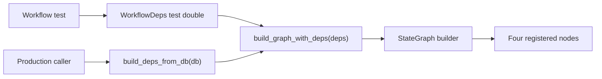

This page explains how backend tests are organized and how workflow dependency injection lets tests isolate graph construction from production services. It focuses on test boundaries, fixtures, and doubles; it does not describe the workflow lifecycle or production database operations. Sources: [test_workflow.py](backend/tests/test_workflow.py#L1-L14) [dependencies.py](backend/app/workflow/dependencies.py#L1-L6)

## Test layers and what they verify

The backend suite combines focused tests, API-level tests, and a limited end-to-end-style test. Workflow tests verify state typing, graph construction, node registration, and checkpoint behavior. Service tests exercise selected services with mocks or isolated temporary storage. API tests use FastAPI’s `TestClient` with an in-memory SQLite database. The integration test covers API operations, but explicitly does not execute the full workflow against its test database. Sources: [test_workflow.py](backend/tests/test_workflow.py#L16-L64) [test_services.py](backend/tests/test_services.py#L16-L24) [test_api.py](backend/tests/test_api.py#L26-L53) [test_integration.py](backend/tests/test_integration.py#L82-L90)

| Test layer | Typical boundary | Verified examples |
|---|---|---|
| Workflow unit/assembly | In-memory doubles; no real database required for graph compilation | State fields, graph compilation, registered node names |
| Workflow checkpoint | `InMemorySaver` | Graph state can be saved and read back after reaching an interrupt |
| Service | Mocked external client or temporary filesystem | LLM response parsing and retries; file-storage operations |
| API | `TestClient` plus in-memory SQLite | HTTP behavior and persistence within the test database |
| Integration-style API flow | `TestClient`; external AI services are not the focus | Position, candidate, and interview endpoint sequence; not a full workflow run |

Sources: [test_workflow.py](backend/tests/test_workflow.py#L18-L64) [test_workflow.py](backend/tests/test_workflow.py#L76-L124) [test_services.py](backend/tests/test_services.py#L16-L24) [test_services.py](backend/tests/test_services.py#L92-L107) [test_api.py](backend/tests/test_api.py#L28-L53) [test_integration.py](backend/tests/test_integration.py#L82-L90)

## Workflow dependency injection: the seam for test doubles

A workflow node’s dependencies are grouped in the `WorkflowDeps` dataclass: database session, repositories, file storage, SSE manager, and prompt renderer. The workflow module documents that tests can inject these dependencies instead of opening a real database session. LLM functions are imported lazily within nodes and can be intercepted by patching `app.workflow.nodes.chat_json`. Sources: [dependencies.py](backend/app/workflow/dependencies.py#L19-L32)

`build_graph_with_deps` binds the supplied dependency object to each node using `partial`, then returns a `StateGraph` builder. Production construction uses `build_deps_from_db(db)` to assemble real dependencies; tests pass a mock object instead. The separation means graph assembly can be checked without constructing repositories backed by a live database. Sources: [graph.py](backend/app/workflow/graph.py#L31-L57) [dependencies.py](backend/app/workflow/dependencies.py#L40-L56)

The diagram distinguishes the two dependency sources that converge at graph assembly: tests can provide doubles, while production code can use the database-backed factory. Sources: [graph.py](backend/app/workflow/graph.py#L31-L57) [dependencies.py](backend/app/workflow/dependencies.py#L40-L56)

## Existing workflow test doubles and assertions

For graph assembly checks, `MagicMock(spec=WorkflowDeps)` is passed to `build_graph_with_deps`; tests compile the returned builder and assert that the expected nodes are registered. The `spec` constrains the mock to the declared dependency interface, while these tests avoid exercising node behavior or requiring real repository operations. Sources: [test_workflow.py](backend/tests/test_workflow.py#L43-L64) [test_workflow.py](backend/tests/test_workflow.py#L154-L164)

A separate test constructs `WorkflowDeps` directly with placeholder values and verifies that it is a dataclass with nine fields. This checks the container’s shape, not whether the placeholders implement repository or service behavior. For a node-level test, the declared patch seam is `app.workflow.nodes.chat_json`; the cited workflow test file confirms the seam in its test comments but does not show a node-level LLM patch example. Sources: [test_workflow.py](backend/tests/test_workflow.py#L166-L182) [dependencies.py](backend/app/workflow/dependencies.py#L19-L32)

## Checkpoint doubles and state assertions

The checkpoint round-trip test uses LangGraph’s `InMemorySaver` rather than the SQLite-backed saver, so the test does not depend on a checkpoint file. It compiles a graph with that saver, starts execution on a background thread, and checks that the graph state is queryable and contains the initial interview identifier. The test comment describes execution as stopping at the candidate-wait interrupt when no resume payload is supplied. Sources: [test_workflow.py](backend/tests/test_workflow.py#L76-L124)

This test provides a focused checkpoint/state assertion, not full workflow coverage. In particular, the full pipeline test—including mocked LLM, database operations, interrupt/resume, and report generation—is explicitly skipped pending a complete database-mocking fixture. Sources: [test_workflow.py](backend/tests/test_workflow.py#L141-L149)

## API database fixtures and dependency overrides

The API test fixture creates an in-memory SQLite engine, uses `StaticPool` so connections share the same in-memory database, creates the ORM tables, and disposes the engine after the test. Its `client` fixture replaces the `get_db` dependency used by the API with a generator that yields sessions bound to that engine, then clears `app.dependency_overrides` during teardown. Sources: [test_api.py](backend/tests/test_api.py#L28-L53) [test_api.py](backend/tests/test_api.py#L56-L87)

The test code highlights an important override detail: it imports and overrides `get_db` from `app.deps`, because the API modules use that function object. Overriding a different `get_db` import from `app.database` would not replace the dependency registered by those routes. The integration test uses a similar in-memory engine and override pattern. Sources: [test_api.py](backend/tests/test_api.py#L56-L80) [test_integration.py](backend/tests/test_integration.py#L25-L64)

The integration-style flow is intentionally bounded: its own comments say the workflow starts in a background thread using the global database, so it cannot observe the test database’s candidate data. The test therefore checks HTTP-level behavior and candidate access, not an end-to-end workflow execution. Sources: [test_integration.py](backend/tests/test_integration.py#L84-L90) [test_integration.py](backend/tests/test_integration.py#L110-L137)

## Test configuration and running the suite

Pytest is configured to discover `tests` and files named `test_*.py`, run in automatic asyncio mode, and use verbose output with short tracebacks. Development dependencies include pytest, pytest-asyncio, and pytest-cov. The shared `conftest.py` adds the backend directory to `sys.path` and sets a per-process temporary base directory under the system temp location. Sources: [pyproject.toml](backend/pyproject.toml#L61-L70) [pyproject.toml](backend/pyproject.toml#L85-L90) [conftest.py](backend/tests/conftest.py#L1-L18)

Run tests from the backend directory with `pytest`. For focused diagnosis, select a module or test name, for example `pytest tests/test_workflow.py` or `pytest tests/test_workflow.py -k checkpointer`. The project configuration establishes pytest discovery and options; these commands use pytest’s standard selection syntax. Sources: [pyproject.toml](backend/pyproject.toml#L85-L90) [test_workflow.py](backend/tests/test_workflow.py#L66-L80)

## Practical limits and improvement targets

The current suite directly demonstrates graph assembly with dependency doubles, checkpoint-state inspection with an in-memory saver, service tests using mocked LLM clients, and API tests using an isolated database. It also documents a coverage gap: the full workflow pipeline test remains skipped because complete database mocking has not yet been added. Treat the skipped test as a known limit rather than evidence that interrupt/resume and report generation are covered end to end. Sources: [test_workflow.py](backend/tests/test_workflow.py#L76-L124) [test_services.py](backend/tests/test_services.py#L92-L107) [test_workflow.py](backend/tests/test_workflow.py#L141-L149)

A safe extension path is to add focused node tests that inject a `WorkflowDeps` double, patch `app.workflow.nodes.chat_json` when testing LLM-dependent behavior, and assert only the node’s observable state changes or calls. For broader coverage, build a fixture that binds workflow repositories to the test database before enabling the skipped pipeline test; the existing integration test explicitly identifies the global-database mismatch as a blocker. Sources: [dependencies.py](backend/app/workflow/dependencies.py#L19-L32) [test_workflow.py](backend/tests/test_workflow.py#L146-L149) [test_integration.py](backend/tests/test_integration.py#L84-L90)

## Suggested next reading

Continue with [Frontend Type Checking, Linting, and Production Builds](29-frontend-type-checking-linting-and-production-builds) for the next quality-focused page, or consult [Workflow Dependency Injection and Checkpoint Persistence](12-workflow-dependency-injection-and-checkpoint-persistence) for the broader production architecture behind the workflow test seam. Sources: [graph.py](backend/app/workflow/graph.py#L31-L57) [dependencies.py](backend/app/workflow/dependencies.py#L19-L32)