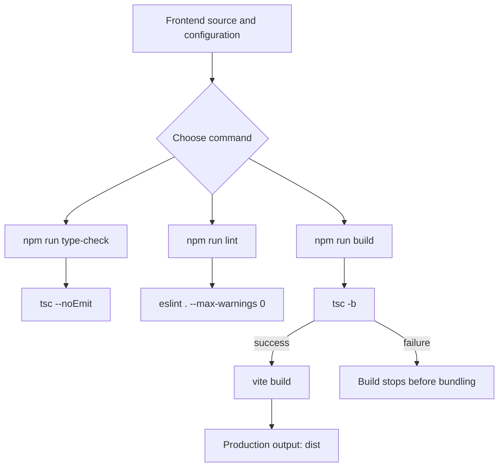

This page explains the frontend’s available validation and build commands, what each command checks, and how the TypeScript and Vite configurations fit together. The package scripts define three separate quality gates: standalone type checking, ESLint, and a production build that runs TypeScript project-build checking before bundling. These commands are defined, but no test results are claimed here. Sources: [package.json](frontend/package.json#L6-L12)

## Validation and build flow

The build pipeline is sequential: `npm run build` runs `tsc -b` first and invokes `vite build` only if that step succeeds. Linting is a separate command; it is not implicitly run by either `npm run build` or `npm run type-check`. Sources: [package.json](frontend/package.json#L6-L12)

Sources: [package.json](frontend/package.json#L6-L12), [vite.config.ts](frontend/vite.config.ts#L33-L38)

## Commands and when to use them

Run these commands from the `frontend` directory, where the package scripts and TypeScript/Vite configuration are located. `type-check` performs a no-emit TypeScript check; `lint` runs ESLint over `.` and treats any warning as a failure; and `build` performs project-build checking before creating the Vite production bundle. Sources: [package.json](frontend/package.json#L6-L12)

| Command | What it runs | Use |
|---|---|---|
| `npm run type-check` | `tsc --noEmit` | Run the standalone TypeScript check without emitting output. |
| `npm run lint` | `eslint . --max-warnings 0` | Check the frontend tree with ESLint; warnings fail the command. |
| `npm run build` | `tsc -b && vite build` | Check TypeScript project references, then create the production bundle if checking succeeds. |
| `npm run dev` | `vite` | Start the Vite development server; this is not a lint or production-build check. |
| `npm run preview` | `vite preview` | Preview the built site using Vite’s preview server. |

Sources: [package.json](frontend/package.json#L6-L12)

## TypeScript configuration boundaries

The application TypeScript configuration enables `strict` checking, unused-local and unused-parameter checks, fallthrough checks, and side-effect import checks. It uses bundler-style module resolution, React’s automatic JSX runtime, and the `@/*` alias for paths under `src`. Its `include` is `src`, and it references `tsconfig.node.json`. Sources: [tsconfig.json](frontend/tsconfig.json#L2-L34)

The referenced Node-side configuration is composite and includes `vite.config.ts`; it applies strict and unused-code checks there as well. This separates application source checking from Vite configuration checking while allowing `tsc -b` to traverse the project reference. Sources: [tsconfig.node.json](frontend/tsconfig.node.json#L1-L20), [tsconfig.json](frontend/tsconfig.json#L25-L34)

| Scope | Configuration | Included files | Relevant behavior |
|---|---|---|---|
| Application | `tsconfig.json` | `src` | Strict checks, no emit, `@/*` path mapping, reference to the Node-side project. |
| Vite configuration | `tsconfig.node.json` | `vite.config.ts` | Composite project with strict and unused-code checks. |

Sources: [tsconfig.json](frontend/tsconfig.json#L2-L34), [tsconfig.node.json](frontend/tsconfig.node.json#L1-L20)

## Production bundle settings

Vite writes production output to `dist`, enables source maps, and sets the chunk-size warning threshold to 500 KB. That threshold is a warning configuration, distinct from the ESLint script’s explicit zero-warning policy; the package script does not show a command-line option that makes Vite chunk warnings fatal. Sources: [vite.config.ts](frontend/vite.config.ts#L33-L38), [package.json](frontend/package.json#L6-L12)

The Vite configuration also registers the React and Tailwind plugins and defines the `@` alias as `src`. The TypeScript configuration independently maps `@/*` to `./src/*`; keeping both mappings consistent allows the alias to be recognized by the type checker and Vite resolver. Sources: [vite.config.ts](frontend/vite.config.ts#L1-L13), [tsconfig.json](frontend/tsconfig.json#L25-L29)

## Practical verification sequence

For a focused edit, run `npm run type-check` and `npm run lint` to check types and lint rules independently. Before producing or validating a release bundle, run `npm run build`; it repeats its own TypeScript project-build step and then bundles with Vite. The scripts do not define a combined lint-and-build command. Sources: [package.json](frontend/package.json#L6-L12)

Sources: [package.json](frontend/package.json#L6-L12), [vite.config.ts](frontend/vite.config.ts#L33-L38)

## Dependency installation and lockfiles

The frontend contains both `package-lock.json` and `pnpm-lock.yaml`, while `package.json` defines the scripts and dependency declarations. The repository files alone do not establish which package manager is mandated for every workflow; use the project’s team or CI convention when choosing an install command, and avoid casually regenerating one lockfile with a different package manager. Sources: [package.json](frontend/package.json#L1-L12), [package-lock.json](frontend/package-lock.json#L1-L5), [pnpm-workspace.yaml](frontend/pnpm-workspace.yaml#L1-L3)

## Related reading

For frontend runtime and tooling context, continue with [React Application Entry, Routing, and Page Responsibilities](22-react-application-entry-routing-and-page-responsibilities), [Accessible UI Primitives, Styling, and Shared Components](27-accessible-ui-primitives-styling-and-shared-components), or operational deployment implications in [Docker Compose, Nginx, and SSE-Aware Deployment](30-docker-compose-nginx-and-sse-aware-deployment). Sources: [package.json](frontend/package.json#L6-L12), [vite.config.ts](frontend/vite.config.ts#L33-L38)