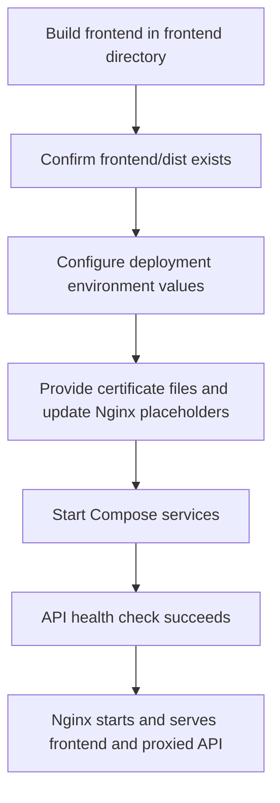

This page explains how the repository’s Compose deployment connects the FastAPI container to Nginx, serves the built frontend, and configures the interview-events endpoint for Server-Sent Events (SSE). The checked-in deployment consists of two services; the frontend is built separately and mounted into Nginx, rather than built by a frontend container. **Important operational constraint:** the HTTPS server references placeholder domain and certificate names, so production use requires configuring those values and providing matching certificate files before Nginx can serve HTTPS. Sources: [docker-compose.yml](docker-compose.yml#L3-L6), [nginx.conf](nginx/nginx.conf#L40-L55), [SSL README](nginx/ssl/README.md#L3-L6)

## Deployment topology

Compose builds the API image from `backend/Dockerfile` and starts Nginx from the `nginx:1.27-alpine` image. Nginx reaches the API through the Compose service hostname `api` on port `8000`; host ports `80` and `443` are published for Nginx, while the API also publishes port `8000` directly. Nginx waits for the API’s health check to pass before starting. Sources: [docker-compose.yml](docker-compose.yml#L9-L15), [docker-compose.yml](docker-compose.yml#L21-L22), [docker-compose.yml](docker-compose.yml#L37-L42), [docker-compose.yml](docker-compose.yml#L49-L57), [nginx.conf](nginx/nginx.conf#L34-L38)

```mermaid
flowchart LR
    Browser -->|HTTP :80 redirects to HTTPS| Nginx[Nginx :80 / :443]
    Browser -->|HTTPS :443| Nginx
    Nginx -->|/api/interviews/{id}/events| SSE[SSE proxy location]
    Nginx -->|/api/| API[FastAPI api:8000]
    SSE --> API
    Nginx -->|/ and SPA routes| Frontend[Mounted frontend/dist]
    API -->|SQLite| DB[(backend/interview.db)]
    API -->|Uploaded and generated files| Storage[(backend/storage)]
```

The diagram reflects the configured routing and mounts: Nginx serves the frontend build directory and proxies API requests to the `api_backend` upstream, while Compose binds the SQLite database and storage directory into the API container. Sources: [nginx.conf](nginx/nginx.conf#L34-L38), [nginx.conf](nginx/nginx.conf#L50-L84), [docker-compose.yml](docker-compose.yml#L16-L20), [docker-compose.yml](docker-compose.yml#L59-L63)

## Compose services and runtime behavior

| Service | Build or image | Published ports | Key runtime behavior |
|---|---|---|---|
| `api` | Built from `./backend` using `backend/Dockerfile` | `8000:8000` | Persists storage and SQLite through bind mounts; health-checks `/healthz`; restarts unless stopped. |
| `nginx` | `nginx:1.27-alpine` | `80:80`, `443:443` | Waits for the API to become healthy; mounts Nginx configuration, SSL directory, and frontend build output read-only. |

The API container receives database, storage, LLM, JWT, Whisper, logging, and CORS-related environment settings from Compose. Defaults are supplied for selected values, including the LLM provider, model, JWT algorithm, log level, and Whisper settings; API keys and the JWT secret are interpolated from the environment. Compose also configures JSON-file log rotation with a 10 MB size limit and three files for each service. Sources: [docker-compose.yml](docker-compose.yml#L23-L36), [docker-compose.yml](docker-compose.yml#L43-L47), [docker-compose.yml](docker-compose.yml#L64-L68)

The backend image uses a builder stage to install Python dependencies, followed by a slim runtime stage. The runtime installs FFmpeg and native libraries used by application features, copies the virtual environment and application source, runs as the non-root `appuser`, and launches Uvicorn on `0.0.0.0:8000`. Its image-level health check targets `/healthz`; Compose defines a corresponding health check with a 60-second startup period, three retries, and a 30-second interval. Sources: [Dockerfile](backend/Dockerfile#L7-L32), [Dockerfile](backend/Dockerfile#L34-L76), [docker-compose.yml](docker-compose.yml#L37-L42)

## Nginx request routing

The HTTPS server handles three traffic classes. Requests to `/` are served from `/usr/share/nginx/html`, with `try_files` falling back to `index.html` for client-side routes. The more specific interview-events location proxies matching event URLs to the backend. Other `/api/` requests use the standard API proxy location, which also sets a 50 MB request-body limit. Sources: [nginx.conf](nginx/nginx.conf#L40-L55), [nginx.conf](nginx/nginx.conf#L57-L84)

The HTTP server exposes an ACME challenge location rooted at `/var/www/certbot` and redirects other requests to HTTPS. The Compose file does not mount a Certbot webroot into that path, nor does it define a Certbot service; therefore, the presence of the location alone does not provide a complete automated certificate-issuance or renewal deployment. Sources: [nginx.conf](nginx/nginx.conf#L87-L101), [docker-compose.yml](docker-compose.yml#L49-L68)

## SSE-specific proxy behavior

The event-stream location matches `/api/interviews/{numeric-id}/events`. It disables proxy buffering and caching, sets one-hour read and send timeouts, uses HTTP/1.1, and clears the `Connection` header. These settings are intended to let streamed response data pass through without Nginx buffering it and to permit a long-lived proxied request. The regular `/api/` location does not define those SSE-specific buffering and timeout settings. Sources: [nginx.conf](nginx/nginx.conf#L57-L70), [nginx.conf](nginx/nginx.conf#L72-L84)

| Directive | Configured value | Deployment effect |
|---|---|---|
| `proxy_buffering` | `off` on the events location | Prevents Nginx from buffering the proxied event response. |
| `proxy_cache` | `off` on the events location | Disables proxy caching for that stream route. |
| `proxy_read_timeout` | `1h` on the events location | Allows a long interval while waiting for upstream response data. |
| `proxy_send_timeout` | `1h` on the events location | Allows a long interval for sending data to the upstream. |
| `proxy_http_version` | `1.1` | Uses HTTP/1.1 for upstream proxying. |
| `Connection` | Empty value on both API locations | Forwards an empty `Connection` header value rather than setting a connection token. |

These directives configure the Nginx-to-API hop; they do not guarantee that every client, network intermediary, or application-level event source remains connected indefinitely. The one-hour values are explicit proxy timeouts, not an unlimited connection lifetime. Sources: [nginx.conf](nginx/nginx.conf#L57-L69)

## Build and bring-up sequence

The Compose configuration expects the frontend build to exist at `frontend/dist` and mounts that directory read-only into Nginx. The Compose file comment specifies building the frontend first with `pnpm build` from the `frontend` directory. No frontend Dockerfile or frontend build service is present in this deployment definition. Sources: [docker-compose.yml](docker-compose.yml#L59-L63)



The sequence distinguishes repository requirements from deployment-specific preparation: Compose declares that Nginx depends on a healthy API, while its mounted frontend path and Nginx TLS configuration must also be ready for the intended deployment. The repository’s SSL instructions require certificate and key filenames to match the paths in `nginx.conf`, and the checked-in server name and certificate names are placeholders. Sources: [docker-compose.yml](docker-compose.yml#L53-L63), [nginx.conf](nginx/nginx.conf#L40-L48), [SSL README](nginx/ssl/README.md#L3-L6)

## TLS and configuration checks

Before enabling the HTTPS configuration, replace `your-domain.com` and the certificate filename placeholders in `nginx.conf` with deployment-specific values, then place the matching certificate and private key in the mounted `nginx/ssl` directory. That directory is mounted read-only in the Nginx container. The SSL README warns against committing real certificate material and notes that `.pem` and `.key` files are ignored by Git. Sources: [nginx.conf](nginx/nginx.conf#L40-L48), [docker-compose.yml](docker-compose.yml#L59-L61), [SSL README](nginx/ssl/README.md#L3-L6)

The root `.env.example` documents example values for LLM credentials, JWT signing, CORS, Whisper, and logging. Compose passes a subset of these settings into the API container, and supplies its own defaults for some of them. Review the actual Compose interpolation and application expectations before deployment; the example file is a template, not evidence that all listed settings are passed through by Compose. Sources: [.env.example](.env.example#L1-L44), [docker-compose.yml](docker-compose.yml#L23-L36)

## Operational checks and limits

| Check | What the repository configures | Practical implication |
|---|---|---|
| API readiness | `/healthz` check, 30-second interval, 10-second timeout, three retries, 60-second start period | Nginx startup is gated on API health, not merely container creation. |
| Persistent API data | Bind mounts for `backend/storage` and `backend/interview.db` | Data is stored on the host paths rather than only in the container filesystem. |
| Frontend availability | Read-only mount of `frontend/dist` | The frontend must be built and present at that host path for Nginx to serve it. |
| TLS files | Read-only mount of `nginx/ssl`; fixed certificate paths in Nginx | The mounted directory must contain files matching the configured paths. |
| API exposure | Host port `8000` is published in addition to Nginx ports | The API is reachable through a host-published port as well as through Nginx’s internal upstream. |

These checks follow directly from the Compose and Nginx configuration. In particular, Nginx’s API dependency uses `service_healthy`, while the API port is separately published; the configuration therefore does not restrict API access to traffic routed through Nginx. Sources: [docker-compose.yml](docker-compose.yml#L16-L22), [docker-compose.yml](docker-compose.yml#L37-L42), [docker-compose.yml](docker-compose.yml#L53-L63), [nginx.conf](nginx/nginx.conf#L34-L38)

## Continue reading

For the SSE endpoint’s application-level event behavior, continue with [Server-Sent Events and Real-Time Progress Delivery](19-server-sent-events-and-real-time-progress-delivery) and [SSE Subscription and Typed Event Handling](26-sse-subscription-and-typed-event-handling). For related persistence and operational guidance, see [Persistent Files, Database Backups, and Operational Safety](31-persistent-files-database-backups-and-operational-safety). Sources: [nginx.conf](nginx/nginx.conf#L57-L70), [docker-compose.yml](docker-compose.yml#L16-L20)