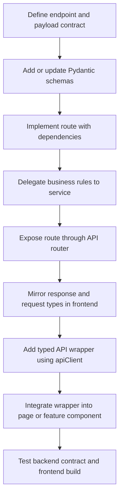

This guide describes the verified extension pattern for a feature that crosses the FastAPI backend and React frontend. It uses the positions feature as a reference: backend routes validate requests, delegate business behavior to a service, and return a shared response envelope; frontend API modules call the shared Axios client, while pages handle user interaction and rendering. The guide focuses on implementation sequencing, contract alignment, and integration tests—not on general API, service, or frontend architecture. Sources: [positions.py](backend/app/api/positions.py#L11-L26), [position_service.py](backend/app/services/position_service.py#L15-L22), [positions.ts](frontend/src/api/positions.ts#L1-L5), [PositionsPage.tsx](frontend/src/pages/PositionsPage.tsx#L28-L53)

## Cross-layer implementation path

The central engineering task is to keep one contract coherent across layers. A feature’s request and response shapes are defined by backend schemas and surfaced through the route; its frontend types and API wrapper must mirror those shapes. The page then consumes the wrapper rather than constructing HTTP requests itself. Sources: [position.py](backend/app/schemas/position.py#L11-L48), [positions.py](backend/app/api/positions.py#L29-L48), [positions.ts](frontend/src/api/positions.ts#L6-L36), [PositionsPage.tsx](frontend/src/pages/PositionsPage.tsx#L13-L15)

The diagram reflects the observed positions implementation: route handlers receive schema-typed input and dependencies, instantiate a service, and wrap results in `APIResponse`; the frontend defines corresponding TypeScript interfaces, uses `apiClient`, and presents results through a page. Sources: [positions.py](backend/app/api/positions.py#L29-L67), [position_service.py](backend/app/services/position_service.py#L15-L22), [positions.ts](frontend/src/api/positions.ts#L6-L69), [PositionsPage.tsx](frontend/src/pages/PositionsPage.tsx#L39-L52)

## Step 1: Specify the contract before coding

Write down the HTTP method, path, authentication expectation, query parameters or request body, success status, and response data shape before implementing either side. The positions routes demonstrate a consistent contract: list uses pagination and an optional bounded status filter; create accepts `PositionCreate` and returns `201`; detail, update, and delete use a path identifier. All five handlers require `get_current_user` and `get_db`. Sources: [positions.py](backend/app/api/positions.py#L26-L36), [positions.py](backend/app/api/positions.py#L51-L67), [positions.py](backend/app/api/positions.py#L70-L112)

| Contract dimension | Verified positions pattern | Feature design action |
|---|---|---|
| Route location | Feature-specific router with a resource prefix | Add the endpoint to the relevant `backend/app/api` module |
| Input validation | Pydantic request model and FastAPI `Query` constraints | Define body/query constraints at the API boundary |
| Authentication and database | `Depends(get_current_user)` and `Depends(get_db)` | Decide explicitly whether the endpoint needs either dependency |
| Business behavior | Route delegates to a service | Keep domain rules out of HTTP orchestration |
| Success response | `APIResponse.ok(...)`, with `201` for creation | Specify envelope and HTTP status consistently |
| Frontend shape | TypeScript interfaces mirror backend schema output | Keep API-facing types aligned with the contract |

Sources: [positions.py](backend/app/api/positions.py#L11-L67), [position.py](backend/app/schemas/position.py#L11-L48), [response.py](backend/app/schemas/response.py#L1-L200), [positions.ts](frontend/src/api/positions.ts#L6-L36)

## Step 2: Define request and response schemas

Add or extend a module under `backend/app/schemas` for the feature’s public request and response shapes. The positions example separates a shared base model, create input, update input, output model, and list envelope. Its output model enables `from_attributes=True`, allowing the route to validate ORM-backed objects with `PositionOut.model_validate(...)`. Sources: [position.py](backend/app/schemas/position.py#L11-L48), [positions.py](backend/app/api/positions.py#L41-L47), [positions.py](backend/app/api/positions.py#L67-L67)

Do not assume the example’s optional-field semantics fit every update operation. In `PositionUpdate`, fields default to `None`, and the route passes their values to the service; the service uses `None` to determine which fields were supplied for its audit metadata. If a new feature must distinguish “not supplied” from “explicitly set to null,” model and test that distinction deliberately rather than copying this shape without checking the domain requirement. Sources: [position.py](backend/app/schemas/position.py#L26-L33), [positions.py](backend/app/api/positions.py#L82-L100), [position_service.py](backend/app/services/position_service.py#L86-L125)

## Step 3: Implement route orchestration and service behavior

Create or extend a feature router with a resource prefix and tags. The route module imports dependencies, schemas, the response envelope, and the service; each handler performs HTTP-level orchestration and passes authenticated actor context into the service where relevant. The positions feature uses `user.id` as `actor_id`, computes the list offset from `page` and `page_size`, and converts ORM objects to schema outputs. Sources: [positions.py](backend/app/api/positions.py#L11-L26), [positions.py](backend/app/api/positions.py#L29-L48), [positions.py](backend/app/api/positions.py#L51-L67)

Place domain rules and persistence coordination in a service rather than expanding route handlers. In the verified example, the service owns validation, not-found behavior, repository calls, audit records, and deletion conflict checks. That boundary lets routes focus on HTTP inputs, dependencies, and response construction. Sources: [position_service.py](backend/app/services/position_service.py#L15-L22), [position_service.py](backend/app/services/position_service.py#L36-L44), [position_service.py](backend/app/services/position_service.py#L46-L84), [position_service.py](backend/app/services/position_service.py#L127-L155)

Register a new router in the aggregate API router. `backend/app/api/router.py` imports each feature module and includes its router; `backend/app/main.py` includes that aggregate router in the FastAPI app. A route file that is not included in the aggregate is not part of the application’s registered API surface. Sources: [router.py](backend/app/api/router.py#L6-L18), [main.py](backend/app/main.py#L189-L192)

## Step 4: Mirror the contract in the frontend API module

Add a feature API module under `frontend/src/api`. Define TypeScript types for the backend response and input payloads, then expose focused functions that call the shared `apiClient`. The positions wrapper returns the inner `data` value from the backend envelope, so callers work with `Position` or `PositionListResponse` rather than repeating envelope extraction. Sources: [positions.ts](frontend/src/api/positions.ts#L6-L36), [positions.ts](frontend/src/api/positions.ts#L45-L69)

Use the shared client instead of creating a feature-specific Axios instance. The shared client sets the base URL and timeout, attaches the stored access token, attempts refresh and retries eligible unauthorized requests, and converts recognized backend error envelopes into `ApiError`. This means new wrappers inherit the existing request and error-handling behavior. Sources: [client.ts](frontend/src/api/client.ts#L14-L40), [client.ts](frontend/src/api/client.ts#L42-L49), [client.ts](frontend/src/api/client.ts#L51-L98)

## Step 5: Connect the API wrapper to the UI

Keep endpoint calls in the feature API module and call that module from the page or component. `PositionsPage` loads the list through `positionsApi.list`, calls `create` or `update` on form submission, and calls `delete` after confirmation. The page owns interaction state, form handling, notifications, and rendering; the wrapper owns HTTP details. Sources: [positions.ts](frontend/src/api/positions.ts#L45-L69), [PositionsPage.tsx](frontend/src/pages/PositionsPage.tsx#L28-L53), [PositionsPage.tsx](frontend/src/pages/PositionsPage.tsx#L74-L103)

For user-entered data, align client-side validation with the backend’s accepted values, while treating server-side validation as authoritative. The positions page uses a Zod schema for required name, minimum quantity, and the status range; the backend schema supplies field types and the service applies business checks such as nonblank names and valid status values. Sources: [PositionsPage.tsx](frontend/src/pages/PositionsPage.tsx#L17-L26), [position.py](backend/app/schemas/position.py#L12-L33), [position_service.py](backend/app/services/position_service.py#L46-L67)

## Step 6: Verify the feature at the API boundary

Add backend integration coverage for the externally observable contract: successful requests, validation or business failures, authentication behavior where applicable, and response envelope and payload fields. The existing API test module uses an in-memory SQLite engine, overrides the `get_db` dependency, and provides authenticated-user fixtures; use its setup pattern when the feature relies on the same database dependencies. Sources: [test_api.py](backend/tests/test_api.py#L26-L86), [test_api.py](backend/tests/test_api.py#L89-L120), [test_api.py](backend/tests/test_api.py#L161-L195)

Run the backend tests relevant to the feature and the frontend checks available in the repository. The frontend package defines `type-check`, `lint`, and `build` scripts; the build script runs TypeScript project builds before Vite bundling. These scripts are repository-defined verification commands, not evidence that any particular feature has passed them. Sources: [package.json](frontend/package.json#L5-L12)

## Contract drift checks

| Drift risk | What to compare |
|---|---|
| Route not registered | Feature router inclusion in the aggregate router |
| Wrong URL or verb | Router prefix/decorator against frontend wrapper path and method |
| Response nesting mismatch | Backend `APIResponse` shape against frontend envelope extraction |
| Type mismatch | Pydantic schema output fields against TypeScript interfaces |
| Validation mismatch | Query/body constraints and service rules against form validation |
| Error-handling mismatch | Backend error envelope against shared `ApiError` conversion and page handling |
| Missing integration coverage | Test request, status code, envelope, and expected data fields |

The shared client only converts a response into `ApiError` when the response body has a numeric, nonzero `code`; other failures are rejected as transport or Axios errors. Pages should therefore avoid assuming that every caught value has the same shape unless they narrow or normalize it. Sources: [client.ts](frontend/src/api/client.ts#L87-L97), [PositionsPage.tsx](frontend/src/pages/PositionsPage.tsx#L89-L103)

## Recommended next reading

For the surrounding contract conventions, see [API Contracts, Validation, and Error Handling](8-api-contracts-validation-and-error-handling). To understand service boundaries before adding business behavior, continue with [Service Layer, Repositories, and Database Sessions](17-service-layer-repositories-and-database-sessions). For the frontend API and authentication mechanics, see [API Client, Authentication State, and Request Handling](23-api-client-authentication-state-and-request-handling); for test setup and backend doubles, see [Backend Test Strategy and Workflow Test Doubles](28-backend-test-strategy-and-workflow-test-doubles). Sources: [positions.py](backend/app/api/positions.py#L11-L26), [client.ts](frontend/src/api/client.ts#L32-L49), [test_api.py](backend/tests/test_api.py#L56-L86)