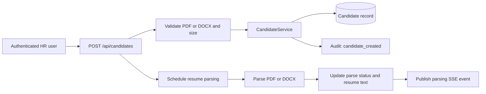
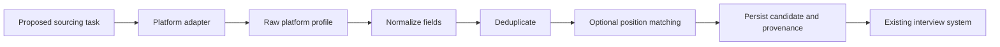

This page separates **implemented candidate intake** from the **proposed sourcing automation**. The current application accepts HR-submitted resumes through an authenticated API and parses them asynchronously; the repository contains no implemented external sourcing adapter or fetch-task subsystem. The separate sourcing design document describes a future direction and explicitly marks it as out of the 2026 Q3 implementation scope. Sources: [candidates.py](backend/app/api/candidates.py#L1-L38), [招聘候选人自动拉取-方案.md](招聘候选人自动拉取-方案.md#L1-L7)

## Current Boundary: Manual Intake Is Implemented

The implemented candidate-creation path is `POST /api/candidates`. It requires the current authenticated user, validates the uploaded file by PDF or DOCX magic bytes, applies a 50 MB limit, and delegates candidate creation to `CandidateService`. The candidate is associated with an existing position and records the uploader. Sources: [candidates.py](backend/app/api/candidates.py#L26-L38), [candidates.py](backend/app/api/candidates.py#L58-L109), [candidate_service.py](backend/app/services/candidate_service.py#L34-L85)

The service creates a UUID-backed candidate row and writes a `candidate_created` audit event. Candidate records currently have position, name, email, resume storage, parsing state, and uploader/timestamps; the model does not define source-platform, source-URL, fetch-time, or match-score fields. These distinctions matter when assessing integration effort: the proposed sourcing metadata is not presently part of the persisted candidate contract. Sources: [candidate_service.py](backend/app/services/candidate_service.py#L61-L85), [candidate.py](backend/app/models/candidate.py#L17-L53)

After creation, the API schedules resume parsing. The parsing task publishes started, complete, or failed SSE events and updates parse status and parsed text. Existing intake therefore already has an asynchronous processing seam, but it is specifically a resume-parsing mechanism—not a general-purpose sourcing queue or adapter framework. Sources: [candidates.py](backend/app/api/candidates.py#L112-L178), [resume_parser_service.py](backend/app/services/resume_parser_service.py#L1-L13)

The diagram depicts the implemented manual intake path only; it does not imply that any external recruitment platform is currently connected. Sources: [candidates.py](backend/app/api/candidates.py#L58-L109), [candidates.py](backend/app/api/candidates.py#L112-L178), [candidate_service.py](backend/app/services/candidate_service.py#L34-L85)

## Proposed Extension: Platform-Neutral Sourcing

The planning document proposes isolating platform-specific retrieval behind an adapter interface. Its suggested adapter contract separates search, candidate-detail retrieval, and a health check, returning raw platform data structures. A registry would select the adapter by platform key, allowing pipeline logic to depend on a common interface rather than platform-specific branches. This is a proposal, not code currently present in `backend/app`. Sources: [招聘候选人自动拉取-方案.md](招聘候选人自动拉取-方案.md#L79-L127)

The proposed pipeline then separates retrieval from normalization, deduplication, scoring, and persistence. That separation is useful as an extension boundary: source-specific parsing remains in adapters, while downstream steps can operate on normalized candidate data. The plan describes LLM-based field extraction and job matching, identity-based deduplication, and persistence; no such sourcing pipeline is implemented in the inspected application services. Sources: [招聘候选人自动拉取-方案.md](招聘候选人自动拉取-方案.md#L47-L76), [招聘候选人自动拉取-方案.md](招聘候选人自动拉取-方案.md#L129-L173)

This is the proposal’s conceptual flow, not a diagram of running components. In particular, the current candidate API and model do not expose a source-provenance schema or a sourcing-task lifecycle. Sources: [招聘候选人自动拉取-方案.md](招聘候选人自动拉取-方案.md#L47-L76), [candidate.py](backend/app/models/candidate.py#L17-L53), [router.py](backend/app/api/router.py#L1-L18)

## Integration Seams and Required Decisions

**Candidate creation is currently coupled to resume-upload inputs.** `CandidateService.create_candidate` requires a position, name, email, and resume type, and accepts resume bytes or a path. A sourcing integration that creates candidates without a resume, or that receives a remote resume URL, would need an explicit policy and an appropriate ingestion path; simply calling the current method does not represent the proposal’s normalized-profile record. Sources: [candidate_service.py](backend/app/services/candidate_service.py#L34-L85), [candidate.py](backend/app/models/candidate.py#L17-L37)

**Position association is a required domain relationship.** Candidate records reference `positions.id`, and position deletion is refused when candidates are associated. A sourcing flow must therefore define how a search task maps to a position before candidate persistence. The existing position API and service provide authenticated position management, but no sourcing-task-to-position mapping exists in the inspected routes. Sources: [candidate.py](backend/app/models/candidate.py#L20-L22), [position_service.py](backend/app/services/position_service.py#L112-L146), [positions.py](backend/app/api/positions.py#L22-L60)

**Resume parsing can be reused only after ingestion provides supported content.** The parser handles PDF and DOCX bytes or files, while the upload endpoint currently performs type checks before scheduling parsing. A future adapter must not assume that a profile page or arbitrary remote document is already a valid parser input; retrieval, content validation, and storage policy must be defined first. Sources: [candidates.py](backend/app/api/candidates.py#L58-L109), [resume_parser_service.py](backend/app/services/resume_parser_service.py#L119-L177)

The existing storage abstraction is another possible seam: `FileStorage` specifies resume save/read operations, and `LocalFileStorage` persists resumes under candidate-specific paths using atomic writes. It does not provide remote fetching, source metadata, or retention behavior; those concerns would need separate design rather than being inferred from the storage interface. Sources: [file_storage.py](backend/app/services/file_storage.py#L24-L53), [file_storage.py](backend/app/services/file_storage.py#L57-L96)

## Proposal Status and Extension Risks

The sourcing design document explicitly labels the feature as long-term planning and outside the stated implementation scope. Its examples include a separate worker, fetch-task records, candidate provenance fields, adapter registration, and staged evolution from a single-platform MVP toward distributed queues and additional storage/observability capabilities. These are design options recorded in that document, not verified properties of the current FastAPI application. Sources: [招聘候选人自动拉取-方案.md](招聘候选人自动拉取-方案.md#L1-L7), [招聘候选人自动拉取-方案.md](招聘候选人自动拉取-方案.md#L15-L46), [招聘候选人自动拉取-方案.md](招聘候选人自动拉取-方案.md#L205-L228)

Before implementation, the plan itself calls for reassessing legal and platform terms, personal-data handling and candidate authorization, anti-bot and platform-change risks, resource costs, data quality, retry policy, and tenant isolation if the product becomes multi-tenant. These are explicit review items in the proposal; they should be treated as prerequisites, not as problems already solved by the current system. Sources: [招聘候选人自动拉取-方案.md](招聘候选人自动拉取-方案.md#L240-L286)

| Concern | Current verified state | Extension decision to make |
|---|---|---|
| Candidate provenance | No source platform or URL fields on `Candidate` | Define provenance fields and migration strategy |
| Intake contract | Authenticated multipart PDF/DOCX upload | Decide how sourced profiles and optional resumes enter the domain |
| Position mapping | Candidate requires `position_id` | Bind each sourcing request to a valid position |
| Background work | Resume parsing is scheduled after upload | Design task ownership, retries, status, and worker behavior separately |
| Audit | Candidate creation is audited | Define task-level and source-data audit requirements |
| Compliance | Audit model documents compliance auditing as a use case | Specify authorization, retention, access controls, and deletion behavior |

Sources: [candidate.py](backend/app/models/candidate.py#L17-L53), [candidates.py](backend/app/api/candidates.py#L58-L109), [candidate_service.py](backend/app/services/candidate_service.py#L61-L85), [audit_log.py](backend/app/models/audit_log.py#L14-L31), [招聘候选人自动拉取-方案.md](招聘候选人自动拉取-方案.md#L240-L286)

## Recommended Reading Path

For the current candidate domain and authenticated access boundary, continue with [Recruitment Domain Model and Data Relationships](7-recruitment-domain-model-and-data-relationships) and [Authentication, Authorization, and Candidate Access](9-authentication-authorization-and-candidate-access). For implementation concerns around service boundaries and background work, see [Service Layer, Repositories, and Database Sessions](17-service-layer-repositories-and-database-sessions) and [Background Scheduling and Stalled Interview Recovery](20-background-scheduling-and-stalled-interview-recovery). Sources: [candidate.py](backend/app/models/candidate.py#L17-L53), [candidates.py](backend/app/api/candidates.py#L26-L38), [candidate_service.py](backend/app/services/candidate_service.py#L34-L85)