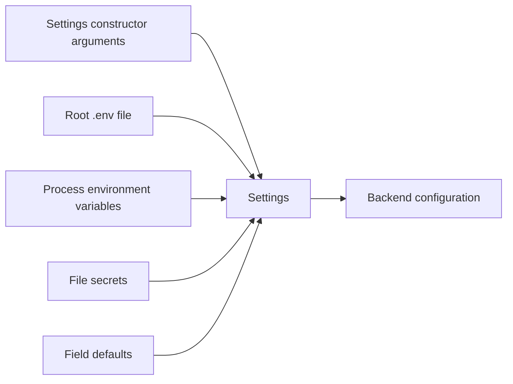

This page explains how to configure the backend for local development and how the repository’s environment-variable template relates to runtime settings and Docker Compose. It focuses on configuration sources, supported settings, and practical setup; it does not cover deployment architecture or application feature behavior. Sources: [.env.example](.env.example#L1-L44), [config.py](backend/app/config.py#L1-L92), [docker-compose.yml](docker-compose.yml#L1-L38)

## Configuration flow

The backend constructs a global `Settings` instance from Pydantic Settings. Configuration can come from constructor arguments, a root-level `.env` file, process environment variables, or file secrets. The configured precedence is **constructor arguments → `.env` → environment variables → file secrets → field defaults**. This is deliberate: for values set in both `.env` and the process environment, `.env` wins. The frontend Vite configuration, by contrast, sets its development server port and API proxy target directly in code rather than reading these backend settings. Sources: [config.py](backend/app/config.py#L1-L20), [config.py](backend/app/config.py#L64-L92), [vite.config.ts](frontend/vite.config.ts#L1-L25)

The diagram shows available sources, not equal precedence: the effective priority is constructor arguments first, then `.env`, environment variables, file secrets, and finally defaults. The `.env` file is configured as UTF-8, setting names are case-sensitive, and unrecognized `.env` entries are ignored. Sources: [config.py](backend/app/config.py#L64-L92)

## Set up local configuration

1. Copy `.env.example` to `.env` in the repository root, then replace placeholder credentials and adjust values for your machine. The template provides local-development defaults for the LLM, SQLite database, file storage, authentication, CORS, Whisper, logging, and API port. Sources: [README.md](README.md#L155-L176), [.env.example](.env.example#L1-L44)

2. Start the backend from the `backend` directory using the documented development command. The settings loader specifies `env_file=".env"`; because it does not specify another path, ensure the `.env` file is discoverable from the process’s working directory. The repository’s documented startup flow runs the backend from `backend`, while the sample file is at repository root; account for that path difference when choosing where to place the `.env` file or how to launch the process. Sources: [README.md](README.md#L155-L176), [config.py](backend/app/config.py#L64-L72)

3. For Compose, run `docker compose up -d` from the repository root after preparing `.env`. Compose interpolates selected values from the host environment or its `.env` file and passes them to the API container; it also sets the container’s database and storage paths explicitly. Sources: [README.md](README.md#L177-L190), [docker-compose.yml](docker-compose.yml#L9-L38)

## Settings reference

The table distinguishes values documented in the template from settings additionally declared in the backend. Defaults and accepted values below are those defined in `Settings`; a template value may override its corresponding default when loaded. Sources: [.env.example](.env.example#L1-L44), [config.py](backend/app/config.py#L20-L63)

| Area | Setting | Backend default / accepted values | Notes |
|---|---|---|---|
| Runtime | `ENV` | `development`; `development`, `staging`, `production` | Declared by the backend; not listed in `.env.example`. |
| Runtime | `LOG_LEVEL` | `INFO`; `DEBUG`, `INFO`, `WARNING`, `ERROR` | Also configures application logging at startup. |
| Runtime | `API_PORT` | `8000` | Declared in the template and backend settings. |
| LLM | `LLM_PROVIDER` | `deepseek`; `deepseek`, `qwen`, `glm` | Provider selection is constrained to these values. |
| LLM | `OPENAI_API_KEY` | Placeholder string | Supply a valid provider key for LLM calls. |
| LLM | `OPENAI_BASE_URL` | `https://api.deepseek.com/v1` | OpenAI-compatible API base URL. |
| LLM | `LLM_MODEL` | `deepseek-chat` | Model name is a string. |
| LLM | `LLM_TEMPERATURE` | `0.1` | Numeric setting. |
| LLM | `LLM_TIMEOUT_SECONDS` | `60` | Backend setting; not listed in the template. |
| LLM | `LLM_MAX_RETRIES` | `3` | Backend setting; not listed in the template. |
| Database | `DATABASE_URL` | `sqlite:///./interview.db` | Template uses `sqlite:///./backend/interview.db`; Compose overrides this to `sqlite:///./interview.db` inside the container. |
| Database | `DB_ECHO` | `false` | Backend setting; not listed in the template. |
| Storage | `STORAGE_PATH` | `./storage` | Template uses `./backend/storage`; Compose overrides this to `/app/storage`. |
| Storage | `MAX_FILE_SIZE_MB` | `50` | Backend setting; not listed in the template. |
| Authentication | `JWT_SECRET_KEY` | Placeholder string | Replace with a strong random secret; the template recommends at least 32 bytes. |
| Authentication | `JWT_ALGORITHM` | `HS256` | Template and backend default agree. |
| Authentication | `JWT_ACCESS_TOKEN_EXPIRE_HOURS` | `24` | Template and backend default agree. |
| Authentication | `JWT_REFRESH_TOKEN_EXPIRE_DAYS` | `7` | Template and backend default agree. |
| CORS | `CORS_ORIGINS` | `http://localhost:5173`, `http://localhost:8000`, `http://127.0.0.1:5173` | Parsed as a list of strings. The template expresses the value as a JSON-style array. |
| Candidate access | `CANDIDATE_TOKEN_LENGTH` | `32` | Template and backend default agree. |
| Speech | `WHISPER_MODEL` | `base`; `tiny`, `base`, `small`, `medium`, `large`, `large-v3` | The template’s optional `large-v3` choice is supported. |
| Speech | `WHISPER_DEVICE` | `auto`; `auto`, `cpu`, `cuda` | The template documents the available device choices. |
| Speech | `WHISPER_TIMEOUT_SECONDS` | `300` | Backend setting; not listed in the template. |

Sources: [.env.example](.env.example#L1-L44), [config.py](backend/app/config.py#L20-L63)

## Values passed into Docker Compose

Compose does not pass every backend setting through to the API container. Its `environment` section explicitly forwards LLM provider and key, base URL, model, JWT key and algorithm, log level, Whisper model and device, and CORS origins. It sets `DATABASE_URL` and `STORAGE_PATH` to container-specific values. Other backend settings may therefore use their code defaults unless supplied through another mechanism. Sources: [docker-compose.yml](docker-compose.yml#L9-L38), [config.py](backend/app/config.py#L20-L63)

Compose supplies fallback values for `LLM_PROVIDER`, `LLM_MODEL`, `JWT_ALGORITHM`, `LOG_LEVEL`, `WHISPER_MODEL`, `WHISPER_DEVICE`, and `CORS_ORIGINS`. It does not provide a fallback for `OPENAI_API_KEY`, `OPENAI_BASE_URL`, or `JWT_SECRET_KEY` in the Compose expression. The template’s `API_PORT` is not used to parameterize the API container’s published port, which is written as `8000:8000`. Sources: [docker-compose.yml](docker-compose.yml#L19-L38), [.env.example](.env.example#L1-L44)

## Local safety and troubleshooting

Keep real credentials in `.env`, not in `.env.example`: `.gitignore` excludes `.env`, `.env.local`, and `.env.*.local`, while the template contains placeholder values. Before sharing configuration, verify that API keys and JWT secrets have not been copied into tracked files. Sources: [.gitignore](.gitignore#L1-L8), [.env.example](.env.example#L1-L3)

If a setting appears to be ignored, check the source precedence first: a loaded `.env` value overrides the same process environment variable, while constructor-provided values override both. Check the process working directory next, because the backend uses the relative `.env` path `.env`. Finally, verify the setting name and type: names are case-sensitive, numeric and constrained settings are validated by their declared types, and extra settings are ignored by the settings model. Sources: [config.py](backend/app/config.py#L64-L92)

For the next onboarding steps, continue with [System Architecture and Component Boundaries](6-system-architecture-and-component-boundaries) to understand where configuration is consumed, then consult [Docker Compose, Nginx, and SSE-Aware Deployment](30-docker-compose-nginx-and-sse-aware-deployment) for deployment-focused guidance. Sources: [config.py](backend/app/config.py#L20-L63), [docker-compose.yml](docker-compose.yml#L1-L8)