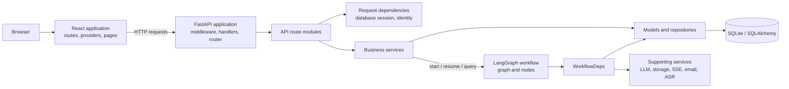
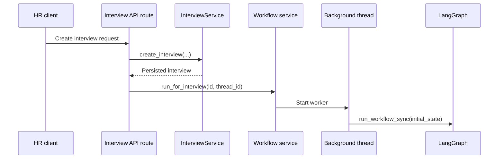

This page explains how the repository divides responsibilities across the React client, FastAPI application, business services, persistence, and interview workflow. It focuses on **component boundaries and runtime relationships**, not on detailed API contracts, data relationships, workflow-node semantics, or deployment operations; those topics have dedicated pages elsewhere in the catalog. The architecture is evidenced by the application entry points, router aggregation, dependency setup, and workflow construction. Sources: [main.py](backend/app/main.py#L129-L200), [router.py](backend/app/api/router.py#L1-L18), [main.tsx](frontend/src/main.tsx#L1-L15)

## Architectural hypothesis

The system is organized as a **web client and API backend**, with a distinct workflow subsystem supporting interview automation. The frontend owns route selection and user-interface composition; the backend application owns HTTP entry points and request-level concerns; services coordinate business operations; models and repositories provide database-facing access; and the LangGraph workflow is assembled separately, with its node dependencies supplied explicitly. This is a logical separation visible in the code, not a claim that each module runs as an independent service. Sources: [routes.tsx](frontend/src/routes.tsx#L18-L44), [main.py](backend/app/main.py#L129-L200), [interview_service.py](backend/app/services/interview_service.py#L21-L29), [graph.py](backend/app/workflow/graph.py#L31-L57)

The diagram represents the observed module relationships: API routes construct services and use request dependencies, while workflow graphs receive a `WorkflowDeps` object that groups database-facing repositories and supporting collaborators. It does not imply that every route uses every dependency or that every service communicates with every integration. Sources: [interviews.py](backend/app/api/interviews.py#L12-L29), [deps.py](backend/app/deps.py#L21-L26), [dependencies.py](backend/app/workflow/dependencies.py#L19-L56), [graph.py](backend/app/workflow/graph.py#L31-L55)

## Frontend boundary: application shell and routes

The frontend starts in `main.tsx`, where React renders the `App` shell around the router. `App` provides the top-level error boundary, authentication context, and notification surface. Route definitions are centralized in `routes.tsx`: login and candidate portal routes are public, while HR routes are nested under an authentication guard and shared application layout. These files establish the frontend’s composition boundary; they do not define the backend’s business rules. Sources: [main.tsx](frontend/src/main.tsx#L1-L15), [App.tsx](frontend/src/App.tsx#L9-L24), [routes.tsx](frontend/src/routes.tsx#L18-L44)

| Frontend area | Verified responsibility | Architectural boundary |
|---|---|---|
| Application entry | Mounts the React tree and supplies the application shell and router. | Browser-side startup and composition. |
| App shell | Wraps children with error and authentication providers and a global toaster. | Shared application-level concerns. |
| Route configuration | Maps public and protected paths to page components. | Client-side navigation and page selection. |

Sources: [main.tsx](frontend/src/main.tsx#L9-L15), [App.tsx](frontend/src/App.tsx#L15-L23), [routes.tsx](frontend/src/routes.tsx#L18-L44)

## Backend boundary: application, routes, and request dependencies

`main.py` is the FastAPI application boundary. It configures the application and CORS, registers exception handlers, includes the aggregated API router, and exposes a health check. Its lifespan function also coordinates startup and shutdown tasks, including database initialization, storage-directory creation, optional Whisper model loading, and scheduler lifecycle. These actions are application lifecycle responsibilities rather than route-specific business logic. Sources: [main.py](backend/app/main.py#L37-L126), [main.py](backend/app/main.py#L129-L200)

`api/router.py` is the route-composition point: it collects authentication, positions, candidates, interviews, candidate-portal, and event routers. Individual route modules define HTTP operations and connect request data to service calls. For example, the interview routes declare a database session and current user as FastAPI dependencies, then construct `InterviewService` for the requested operation. Sources: [router.py](backend/app/api/router.py#L6-L18), [interviews.py](backend/app/api/interviews.py#L29-L51)

The dependency module is a request-boundary adapter. Its `get_db` yields the database session, `get_current_user` resolves and checks a bearer-token user, `get_current_candidate` resolves an interview from a token, and the SSE dependency returns the manager instance. These functions make shared request context available to routes without embedding those mechanics in each route handler. Sources: [deps.py](backend/app/deps.py#L21-L26), [deps.py](backend/app/deps.py#L28-L68), [deps.py](backend/app/deps.py#L84-L108)

## Service and persistence boundary

Services sit between route handlers and persistence-oriented models/repositories. In the interview example, the route creates an `InterviewService` with a database session and actor identifier. The service holds an interview repository and audit repository, and it coordinates related repositories when validating and creating an interview. This makes the service the visible location for multi-step business operations, while the route remains responsible for HTTP input and response construction. Sources: [interviews.py](backend/app/api/interviews.py#L62-L95), [interview_service.py](backend/app/services/interview_service.py#L21-L29), [interview_service.py](backend/app/services/interview_service.py#L73-L130)

Database setup is centralized in `database.py`: it defines the SQLAlchemy base, engine, session factory, request-scoped session generator, and table initialization. The module’s repository/model imports during initialization register the mapped entities before metadata creates tables. This database boundary is shared by request dependencies and other backend components that explicitly create sessions. Sources: [database.py](backend/app/database.py#L19-L24), [database.py](backend/app/database.py#L25-L73), [database.py](backend/app/database.py#L76-L95)

## Workflow boundary: separately assembled automation

Interview automation is represented by a workflow subsystem rather than being folded into the HTTP route layer. The interview creation endpoint calls `run_for_interview` after the service creates an interview; that function starts work on a background thread and prepares an initial state before invoking the graph. This is a concrete route-to-workflow handoff, while the workflow service owns the asynchronous launch boundary. Sources: [interviews.py](backend/app/api/interviews.py#L62-L95), [workflow_service.py](backend/app/services/workflow_service.py#L79-L139)

`graph.py` defines the graph’s node and edge structure and accepts `WorkflowDeps` when building it. The dependency object groups a session, repositories, file storage, SSE manager, and prompt renderer. This explicit dependency assembly creates a testable boundary: graph construction can receive substituted dependencies, while production construction can assemble dependencies from a database session. Sources: [graph.py](backend/app/workflow/graph.py#L31-L57), [graph.py](backend/app/workflow/graph.py#L81-L102), [dependencies.py](backend/app/workflow/dependencies.py#L19-L56)

This sequence is limited to the creation path visible in the interview route and workflow service. The route also attempts invitation email delivery; that side effect is omitted here because the diagram is intended to show the workflow handoff rather than every action in the request. Sources: [interviews.py](backend/app/api/interviews.py#L71-L87), [workflow_service.py](backend/app/services/workflow_service.py#L81-L139)

## Cross-component interaction

The principal boundary crossings are **browser-to-API**, **route-to-service**, **service-to-persistence**, and **application-to-workflow**. The API application centralizes HTTP-level setup; route modules adapt HTTP inputs and dependencies into service calls; services coordinate business operations against repositories; and workflow orchestration runs through its own graph and injected dependencies. Supporting modules such as email, file storage, LLM, ASR, and SSE are present in the backend, but their internal contracts are outside this page’s scope. Sources: [main.py](backend/app/main.py#L129-L200), [interviews.py](backend/app/api/interviews.py#L62-L95), [interview_service.py](backend/app/services/interview_service.py#L21-L29), [dependencies.py](backend/app/workflow/dependencies.py#L19-L32)

| Boundary | Caller | Receiver | Evidence-based responsibility |
|---|---|---|---|
| Client → API | React application | FastAPI routes | The frontend mounts a router; the backend registers API routers. |
| Route → service | API handler | Business service | Interview handlers instantiate and call `InterviewService`. |
| Service → persistence | Business service | Models/repositories and session | The service uses repositories with the supplied session. |
| Workflow launch | Interview route | Workflow service | Interview creation triggers the workflow launcher. |
| Graph → collaborators | LangGraph nodes | `WorkflowDeps` | The graph binds dependencies to nodes during construction. |

Sources: [main.tsx](frontend/src/main.tsx#L9-L15), [main.py](backend/app/main.py#L189-L200), [interviews.py](backend/app/api/interviews.py#L71-L84), [interview_service.py](backend/app/services/interview_service.py#L21-L29), [graph.py](backend/app/workflow/graph.py#L42-L55), [dependencies.py](backend/app/workflow/dependencies.py#L19-L32)

## Reading next

For domain entities and their relationships, continue to [Recruitment Domain Model and Data Relationships](7-recruitment-domain-model-and-data-relationships). For the workflow’s lifecycle and graph execution details, continue to [Interview Workflow State and Lifecycle](10-interview-workflow-state-and-lifecycle) and [LangGraph Nodes, Interrupts, and Resume Semantics](11-langgraph-nodes-interrupts-and-resume-semantics). For frontend-specific ownership, see [React Application Entry, Routing, and Page Responsibilities](22-react-application-entry-routing-and-page-responsibilities). Sources: [routes.tsx](frontend/src/routes.tsx#L18-L44), [graph.py](backend/app/workflow/graph.py#L42-L55), [workflow_service.py](backend/app/services/workflow_service.py#L79-L88)