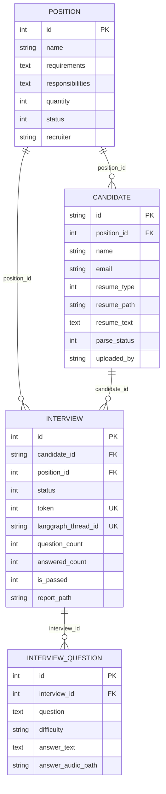

This page explains the recruitment records represented by the backend ORM models: **positions**, **candidates**, **interviews**, and **interview questions**, together with the user and audit records that provide operational context. It focuses on entity boundaries, keys, and persisted relationships—not API behavior, workflow execution, or database operations. Sources: [candidate.py](backend/app/models/candidate.py#L19-L46), [position.py](backend/app/models/position.py#L15-L39), [interview.py](backend/app/models/interview.py#L25-L75), [interview_question.py](backend/app/models/interview_question.py#L18-L53), [user.py](backend/app/models/user.py#L15-L28), [audit_log.py](backend/app/models/audit_log.py#L25-L51)

## The domain in one diagram

The central relationship is a **position–candidate–interview chain**: candidates reference positions, and interviews reference both a candidate and a position. An interview owns its question records. Users and audit logs are related operational concepts, but the inspected models do not declare ORM relationships connecting them to recruitment records. Sources: [candidate.py](backend/app/models/candidate.py#L23-L24), [interview.py](backend/app/models/interview.py#L31-L32), [interview_question.py](backend/app/models/interview_question.py#L22-L23), [user.py](backend/app/models/user.py#L15-L28), [audit_log.py](backend/app/models/audit_log.py#L25-L51)

The diagram expresses the foreign-key structure represented in the models: one position may be referenced by multiple candidates and interviews; one candidate may be referenced by multiple interviews; and one interview may be referenced by multiple questions. These are schema-level relationship interpretations; the models shown declare foreign keys, but do not configure SQLAlchemy `relationship()` attributes for these links. Sources: [candidate.py](backend/app/models/candidate.py#L23-L24), [interview.py](backend/app/models/interview.py#L31-L32), [interview_question.py](backend/app/models/interview_question.py#L22-L23), [position.py](backend/app/models/position.py#L15-L39)

## Core recruitment entities

| Entity | Identifier and links | Domain data | Persisted status or progress |
|---|---|---|---|
| **Position** | Integer primary key `id` | Name, requirements, responsibilities, hiring quantity, optional recruiter name | `status`: 0 not started, 1 in progress, 2 completed |
| **Candidate** | String primary key `id`; `position_id` references `positions.id` | Name, email, resume format and content/path, extracted resume text | `parse_status`: 0 pending, 1 parsing, 2 succeeded, 3 failed |
| **Interview** | Integer primary key `id`; foreign keys to candidate and position | Interviewer, scheduled start/end timestamps, candidate token, workflow thread identifier, report content/path | `status`: 0 not started, 1 questions ready, 2 in progress, 3 completed, 4 report generated |
| **Interview question** | Integer primary key `id`; `interview_id` references `interviews.id` | Question text, optional scoring standard, difficulty, answer text and audio content/path | Answer presence is represented by `answered_at`; there is no separate question status field |

The codes above are documented in model comments. They are integer-backed fields rather than declared enum types, so consumers should treat the documented values as conventions encoded by the application, not as a database enum constraint. Sources: [position.py](backend/app/models/position.py#L26-L28), [candidate.py](backend/app/models/candidate.py#L34-L43), [interview.py](backend/app/models/interview.py#L40-L43), [interview_question.py](backend/app/models/interview_question.py#L40-L51)

### Position and candidate

A position stores the role definition and hiring context: its name, textual requirements and responsibilities, requested quantity, status, and optional recruiter label. A candidate stores identity and resume-related information, including the required position reference. Candidate resume data supports both a legacy binary field and a file path, alongside extracted text and parsing metadata. Sources: [position.py](backend/app/models/position.py#L15-L39), [candidate.py](backend/app/models/candidate.py#L19-L46)

The candidate model comments identify `uploaded_by` as an HR user ID, but that field is a plain string column—not a declared foreign key to `users.id`. Likewise, `Position.recruiter` is a nullable string described as an HR username. These fields provide attribution values, but the model definitions do not enforce referential links to the user table. Sources: [candidate.py](backend/app/models/candidate.py#L42-L46), [position.py](backend/app/models/position.py#L32-L34), [user.py](backend/app/models/user.py#L15-L28)

### Interview and question

An interview links a candidate and position, and carries its own lifecycle data, scheduling timestamps, progress counters, optional pass result, voice-reading setting, and report storage fields. Its unique candidate-facing `token` and unique `langgraph_thread_id` are persisted on the interview record. Sources: [interview.py](backend/app/models/interview.py#L25-L75)

Each interview question belongs to an interview through `interview_id`. The record combines generated content and optional scoring guidance with the candidate’s answer text, answer audio storage, and answer timestamp. Difficulty is stored as a string; the model comment lists `hard`, `medium`, and `easy`, with `medium` as the model default. Sources: [interview_question.py](backend/app/models/interview_question.py#L18-L53)

The interview duplicates some question-derived information as summary fields: `question_count`, `answered_count`, and counts by difficulty. These values live on `Interview`, while individual questions and their answer timestamps live in `InterviewQuestion`. The model therefore represents both detailed question records and interview-level progress/summary fields; the declarations alone do not establish an automatic synchronization rule between them. Sources: [interview.py](backend/app/models/interview.py#L45-L50), [interview_question.py](backend/app/models/interview_question.py#L18-L53)

## Supporting records: users and audit logs

`User` represents HR/admin accounts with a string ID, unique username and email, password hash, optional full name, active/admin flags, and account timestamps. Its model does not define a relationship to positions, candidates, interviews, or audit logs. Sources: [user.py](backend/app/models/user.py#L15-L28)

`AuditLog` stores event type, optional interview/candidate/user identifier values, actor identity and type, JSON metadata, and occurrence time. The three resource identifier columns are nullable indexed values rather than declared foreign keys in this model. The record can therefore carry references to recruitment resources without the ORM schema enforcing those references. Sources: [audit_log.py](backend/app/models/audit_log.py#L25-L51)

## Schema details developers should preserve

Primary-key types differ by entity: positions, interviews, questions, and audit logs use integer primary keys; candidates and users use string primary keys. Foreign-key columns follow the referenced key types—`Candidate.position_id` and `Interview.position_id` are integers, while `Interview.candidate_id` is a string. Sources: [position.py](backend/app/models/position.py#L17-L18), [candidate.py](backend/app/models/candidate.py#L23-L24), [interview.py](backend/app/models/interview.py#L29-L32), [interview_question.py](backend/app/models/interview_question.py#L20-L23), [user.py](backend/app/models/user.py#L17-L18), [audit_log.py](backend/app/models/audit_log.py#L27-L29)

Several payloads have both binary-content and file-path fields: candidate resumes, interview reports, and question answer audio. The model comments describe the binary columns as legacy or compatibility storage and the path columns as newer file-backed storage. Code that reads or writes these assets should account for both representations rather than assume every record uses one form. Sources: [candidate.py](backend/app/models/candidate.py#L28-L31), [interview.py](backend/app/models/interview.py#L59-L63), [interview_question.py](backend/app/models/interview_question.py#L32-L36)

Timestamps are generally stored as integer Unix timestamps in seconds. The model declarations also use nullable timestamp fields where the event may not yet have happened, including interview end time, candidate parse time, and question answer time. Sources: [position.py](backend/app/models/position.py#L35-L39), [candidate.py](backend/app/models/candidate.py#L38-L46), [interview.py](backend/app/models/interview.py#L34-L36), [interview_question.py](backend/app/models/interview_question.py#L48-L53)

## Where to go next

For the boundaries between application components, continue to [System Architecture and Component Boundaries](6-system-architecture-and-component-boundaries). For endpoint-level request and response shapes, see [API Contracts, Validation, and Error Handling](8-api-contracts-validation-and-error-handling). For interview lifecycle semantics, continue to [Interview Workflow State and Lifecycle](10-interview-workflow-state-and-lifecycle). Sources: [candidate.py](backend/app/models/candidate.py#L19-L46), [interview.py](backend/app/models/interview.py#L40-L50)