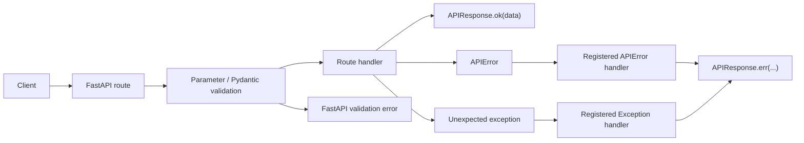

This page explains how the FastAPI backend defines request and response contracts, applies validation, and translates application errors into HTTP responses. It focuses on the API boundary: route declarations, Pydantic schemas, the shared response envelope, and exception handling. Authentication mechanics and the broader service/data architecture are covered separately in [Authentication, Authorization, and Candidate Access](9-authentication-authorization-and-candidate-access) and [Service Layer, Repositories, and Database Sessions](17-service-layer-repositories-and-database-sessions). Sources: [main.py](backend/app/main.py#L1-L30), [router.py](backend/app/api/router.py#L1-L18)

## Contract model

The API boundary has three distinct responsibilities: routers declare paths and transport details; Pydantic models describe JSON request and response shapes; shared wrappers and exception handlers standardize outcomes. The application registers feature routers beneath `/api`, while `/healthz` is a separate liveness endpoint. Sources: [router.py](backend/app/api/router.py#L1-L18), [main.py](backend/app/main.py#L175-L249)

The success path is explicitly modeled with `APIResponse[T]`: `code` is `0` on success, `msg` carries a message, `request_id` is generated by default, and `data` contains the endpoint payload. The `ok` factory constructs this envelope. The application’s registered handlers also use this envelope for `APIError` and unhandled exceptions, although framework-generated request-validation errors are not explicitly normalized by the shown handlers. Sources: [response.py](backend/app/schemas/response.py#L1-L39), [main.py](backend/app/main.py#L137-L173)

| Contract element | Responsibility | Observable behavior |
|---|---|---|
| Router | HTTP method, path, query/form/file inputs, dependencies, response model | Defines endpoint-level transport contract |
| Pydantic request schema | JSON body shape and field types | FastAPI parses and validates declared request bodies |
| Pydantic response schema | Response payload shape | Used by `response_model` and `model_validate` at route boundaries |
| `APIResponse[T]` | Common success/error envelope | Exposes `code`, `msg`, `request_id`, and `data` |
| `APIError` | Application-defined failure | Maps an error code to an HTTP status and is serialized by the application handler |

Sources: [response.py](backend/app/schemas/response.py#L13-L39), [errors.py](backend/app/core/errors.py#L1-L55), [positions.py](backend/app/api/positions.py#L20-L43)

## Request and response shape patterns

JSON body contracts are declared with Pydantic models. For example, position creation accepts a `PositionCreate` body, while position updates accept a `PositionUpdate` model whose fields are optional. The response is wrapped in `APIResponse[PositionOut]`; list endpoints return a paginated payload with `items`, `total`, `page`, and `page_size`. Sources: [position.py](backend/app/schemas/position.py#L9-L48), [positions.py](backend/app/api/positions.py#L46-L82)

| Endpoint pattern | Input contract | Output contract |
|---|---|---|
| List positions | Query parameters: optional status, page, page size | `APIResponse[PositionListResponse]` |
| Create position | JSON `PositionCreate` | `APIResponse[PositionOut]`, HTTP 201 |
| Update position | JSON `PositionUpdate` | `APIResponse[PositionOut]` |
| Upload candidate | Multipart form fields plus required file | `APIResponse[CandidateCreateResponse]`, HTTP 201 |
| Submit candidate answer | Multipart question ID plus required audio file | `APIResponse[SubmitAnswerResponse]` |
| Download interview report | Path ID; no declared response model | Raw PDF response, not the JSON envelope |

These endpoint shapes are not interchangeable: the report download returns binary content with `application/pdf`, whereas the JSON CRUD routes declare envelope response models. Sources: [positions.py](backend/app/api/positions.py#L26-L82), [candidates.py](backend/app/api/candidates.py#L31-L57), [candidate_portal.py](backend/app/api/candidate_portal.py#L105-L117), [interviews.py](backend/app/api/interviews.py#L169-L189)

Multipart endpoints express transport-level requiredness and some constraints directly in FastAPI declarations. Candidate upload requires `name`, `email`, `position_id`, and `resume`; it declares minimum string lengths and a positive position ID. It then checks file magic bytes for PDF or DOCX and rejects content larger than 50 MiB. Candidate answer submission requires both `question_id` and `audio_answer`. Sources: [candidates.py](backend/app/api/candidates.py#L31-L78), [candidate_portal.py](backend/app/api/candidate_portal.py#L105-L117)

## Validation at the API boundary

FastAPI parameter declarations provide basic constraints for query and form inputs. For example, position listing constrains `status` to 0–2, `page` to at least 1, and `page_size` to 1–100. Interview listing similarly bounds `status` to 0–4 and pagination values. These declarations make the accepted ranges visible in the route contract and OpenAPI metadata. Sources: [positions.py](backend/app/api/positions.py#L26-L35), [interviews.py](backend/app/api/interviews.py#L27-L43)

Pydantic schema models define field types and optionality, but the shown schemas do not apply field-level range or string constraints to every business value. `PositionBase`, for instance, types `quantity` and `status` as integers without declaring bounds; `InterviewCreate` types `position_id`, `start_time`, and `is_passed` as optional values without additional constraints. Do not infer stronger schema validation than is declared. Sources: [position.py](backend/app/schemas/position.py#L9-L28), [interview.py](backend/app/schemas/interview.py#L9-L24)

Validation also occurs inside handlers when a rule depends on file content or persisted state. Candidate upload inspects the first bytes rather than trusting a filename or client-supplied media type, and enforces a 50 MiB limit after reading the upload. Answer submission verifies that the question exists and belongs to the current interview, then rejects a second answer when `answered_at` is already set. Sources: [candidates.py](backend/app/api/candidates.py#L53-L78), [candidate_portal.py](backend/app/api/candidate_portal.py#L118-L139)

## Error codes and HTTP mapping

`ErrorCode` groups application errors into numeric ranges: 1001–1999 for parameter/validation errors, 2001–2999 for missing resources, 3001–3999 for business logic, 4001–4999 for authentication or external-service errors, and 5000 for internal errors. `get_status_code` maps these ranges to HTTP statuses, with explicit overrides for authentication, unsupported media type, payload size, and selected external-service failures. Sources: [errors.py](backend/app/core/errors.py#L1-L55), [errors.py](backend/app/core/errors.py#L57-L91)

| Error category / example | Default or explicit HTTP status | Example use |
|---|---:|---|
| Parameter error (`PARAM_*`) | 400 | Invalid request input |
| Missing resource (`*_NOT_FOUND`) | 404 | Missing question or position |
| Business conflict (`INVALID_STATE_TRANSITION`) | 409 | Answer already submitted |
| Invalid credentials | 401 | Login failure |
| Forbidden / disabled user | 403 | Inactive account |
| Unsupported file type | 415 | Non-PDF/DOCX resume |
| File too large | 413 | Upload above configured limit |
| LLM / Whisper failure | 502 | External processing failure |
| Internal error | 500 | Unhandled server failure |

`APIError` is an `HTTPException` subclass. Its constructor stores a structured `detail` containing numeric `code`, `msg`, and `data`; factory methods such as `bad_request`, `not_found`, `conflict`, and `unauthorized` select common HTTP statuses. The global `APIError` handler reads those fields and returns an `APIResponse.err` body using the exception’s HTTP status. Sources: [errors.py](backend/app/core/errors.py#L93-L175), [main.py](backend/app/main.py#L137-L158)

An unhandled exception is logged with its type, message, request path, and exception information, then returned as HTTP 500 with code `INTERNAL_ERROR` and the generic message “服务器内部错误”. This prevents the exception message from being placed in the response body by this handler. Sources: [main.py](backend/app/main.py#L161-L173)

## Contract considerations for callers

For JSON endpoints, callers should inspect both the HTTP status and the envelope’s `code`; the documented success convention is `code == 0`, with useful data under `data`. Error responses from the application’s `APIError` handler use the same envelope and include a `request_id` generated by `APIResponse`. Sources: [response.py](backend/app/schemas/response.py#L13-L39), [main.py](backend/app/main.py#L137-L158)

Not every route produces JSON. The interview report endpoint returns PDF bytes and sets `Content-Disposition`; clients must handle that as a file download rather than parsing an `APIResponse`. Candidate interview creation returns an identifier, token, and status inside the standard success envelope, while asynchronous workflow behavior is outside the immediate response contract. Sources: [interviews.py](backend/app/api/interviews.py#L169-L189), [interviews.py](backend/app/api/interviews.py#L53-L87), [interview.py](backend/app/schemas/interview.py#L46-L52)

## Verification and known boundary

The API integration tests exercise the application through FastAPI’s `TestClient`, override the database dependency, and assert both HTTP status and envelope fields for login cases. This is a useful contract-testing pattern: verify externally observable status codes and body shape rather than only calling route functions directly. Sources: [test_api.py](backend/tests/test_api.py#L1-L73), [test_api.py](backend/tests/test_api.py#L139-L173)

The shown application registers custom handlers for `APIError` and generic `Exception`, but not a dedicated `RequestValidationError` handler. Therefore, this page does not claim that FastAPI’s own malformed-body or parameter-validation responses share the `APIResponse` envelope; verify actual behavior before relying on a uniform client error parser for those cases. Sources: [main.py](backend/app/main.py#L137-L173), [response.py](backend/app/schemas/response.py#L13-L39)

For the adjacent concerns, continue with [Authentication, Authorization, and Candidate Access](9-authentication-authorization-and-candidate-access) for access mechanisms, then [Service Layer, Repositories, and Database Sessions](17-service-layer-repositories-and-database-sessions) for what route handlers delegate to services. Sources: [router.py](backend/app/api/router.py#L1-L18)