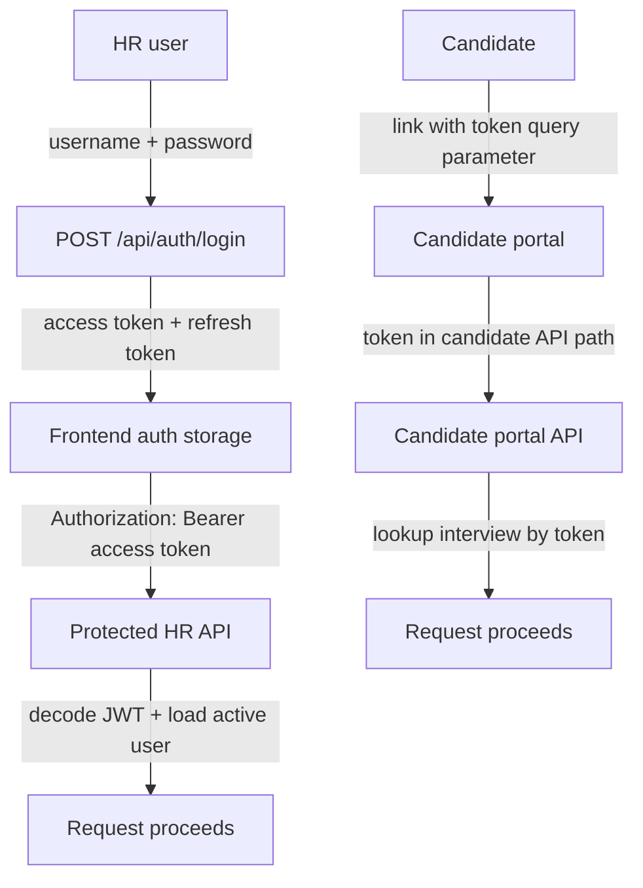

This page explains how the system separates HR authentication from candidate access, where credentials are validated, and how those checks connect to the frontend. **HR endpoints use user-backed JWTs; candidate portal endpoints use an interview-specific URL token.** The code implements authentication and active-account checks, but does not show role-based authorization enforcement: the `is_admin` field exists on users, while the inspected route dependencies require only a current active user. Sources: [security.py](backend/app/core/security.py#L1-L96) [deps.py](backend/app/deps.py#L22-L88) [user.py](backend/app/models/user.py#L14-L27)

## Two access paths

The system has two distinct credential paths. HR signs in with username and password, then supplies a bearer access token for protected API requests. A candidate follows an interview link containing a unique interview token; candidate endpoints resolve that token directly to an interview and do not require an HR JWT.

Sources: [auth.py](backend/app/api/auth.py#L20-L152) [deps.py](backend/app/deps.py#L27-L88) [candidate_portal.py](backend/app/api/candidate_portal.py#L1-L23) [routes.tsx](frontend/src/routes.tsx#L16-L39)

## HR authentication: password verification and JWTs

`POST /api/auth/login` accepts a username and password. It looks up the user by username and verifies the submitted password against the stored password hash. A missing user and a wrong password produce the same invalid-credentials response, and failed attempts are recorded in the audit log. Disabled accounts are rejected separately. On success, the handler updates the last-login timestamp, records a success audit event, and returns access and refresh tokens together with user information. Sources: [auth.py](backend/app/api/auth.py#L20-L107) [user.py](backend/app/models/user.py#L14-L27) [user.py](backend/app/models/user.py#L42-L76)

Passwords are hashed and checked with a Passlib bcrypt context. JWTs carry the user ID as `sub`, a `type` claim, and issued-at and expiry timestamps. Access and refresh token lifetimes are configurable; the settings defaults are 24 hours and 7 days, respectively. `decode_token` verifies the configured signing algorithm and rejects a token whose type does not match the caller’s expected type. Sources: [security.py](backend/app/core/security.py#L19-L71) [config.py](backend/app/config.py#L35-L43)

## Authorization boundary for HR routes

The `get_current_user` dependency is the backend’s HR authentication gate. It requires an `Authorization` header beginning with `Bearer `, decodes the remainder as an access token, reads the subject, loads the matching user, and rejects missing or inactive accounts. Routes that declare this dependency receive the validated `User` object and use its ID as the service actor in the inspected candidate, position, interview, and events endpoints. Sources: [deps.py](backend/app/deps.py#L27-L65) [candidates.py](backend/app/api/candidates.py#L25-L44) [positions.py](backend/app/api/positions.py#L23-L44) [interviews.py](backend/app/api/interviews.py#L23-L53) [events.py](backend/app/api/events.py#L20-L34)

The user model includes an `is_admin` flag, but the inspected dependency checks `is_active` rather than `is_admin`, and the inspected routes use `get_current_user` without an admin-specific policy. Therefore, the verified distinction is authenticated active user versus unauthenticated or inactive user—not a demonstrated administrator-versus-standard-user permission system. Sources: [user.py](backend/app/models/user.py#L14-L27) [deps.py](backend/app/deps.py#L27-L65) [positions.py](backend/app/api/positions.py#L23-L44)

## Candidate access: interview-scoped URL token

An interview stores a unique token. The repository creates one when creating an interview unless an explicit token is supplied; the default length comes from configuration and the generator selects characters using `secrets.choice` over ASCII letters and digits. The database column is both unique and indexed. The interview-creation endpoint returns the token and builds the invitation URL with it as the `token` query parameter. Sources: [security.py](backend/app/core/security.py#L74-L96) [config.py](backend/app/config.py#L49-L51) [interview.py](backend/app/models/interview.py#L52-L57) [interview.py](backend/app/models/interview.py#L118-L145) [interviews.py](backend/app/api/interviews.py#L62-L108)

Candidate portal API routes place that credential in the URL path, for example `/api/candidate/{token}/info`. `get_current_candidate` rejects an empty token, searches for an interview with the exact token, and returns a not-found error if no match exists. It does not decode a JWT or require an HR user. The portal handlers then operate on the resolved interview; answer submission additionally verifies that the requested question belongs to that interview and has not already been answered. Sources: [deps.py](backend/app/deps.py#L68-L88) [candidate_portal.py](backend/app/api/candidate_portal.py#L20-L24) [candidate_portal.py](backend/app/api/candidate_portal.py#L105-L136)

The candidate token grants access through possession of the URL credential. In the inspected dependency, access is based on whether the token resolves to an interview; there is no separate candidate login or additional expiry check shown. Treat the link accordingly: avoid exposing it unnecessarily, and do not interpret the interview’s workflow status as an additional authentication boundary. Sources: [deps.py](backend/app/deps.py#L68-L88) [interview.py](backend/app/models/interview.py#L52-L57)

## Frontend behavior and request lifecycle

The frontend keeps HR authentication state under the `interview_auth` localStorage key. `AuthContext` restores the stored user on startup, and `AuthGuard` shows a loading state while that restoration runs; it redirects unauthenticated visitors to `/login`, preserving the current pathname in a redirect parameter. The router leaves `/login` and `/candidate-portal` public while nesting the HR application routes under `AuthGuard`. Sources: [auth.ts](frontend/src/lib/auth.ts#L1-L62) [AuthContext.tsx](frontend/src/contexts/AuthContext.tsx#L23-L68) [AuthGuard.tsx](frontend/src/components/AuthGuard.tsx#L16-L35) [routes.tsx](frontend/src/routes.tsx#L16-L39)

The API client reads the stored access token and adds it as a bearer header to requests. On an HTTP 401 response, it makes one refresh attempt when a refresh token is available, stores the returned token state, and retries the original request. If refresh fails, it clears local auth state and navigates to `/login`. Requests to `/api/auth/` are excluded from this refresh branch. The storage module explicitly notes that localStorage is exposed to theft in an XSS scenario and identifies HttpOnly cookies as a possible future alternative; this describes the current implementation’s documented trade-off, not an implemented cookie flow. Sources: [client.ts](frontend/src/api/client.ts#L33-L88) [auth.ts](frontend/src/lib/auth.ts#L1-L62)

The candidate portal reads `token` from the page query string and passes it to the candidate portal API. Its public route does not depend on the HR `AuthGuard`; the backend validates the token on each candidate endpoint through the interview lookup dependency. Sources: [CandidatePortalPage.tsx](frontend/src/pages/CandidatePortalPage.tsx#L25-L53) [routes.tsx](frontend/src/routes.tsx#L16-L21) [candidate_portal.py](backend/app/api/candidate_portal.py#L20-L24) [deps.py](backend/app/deps.py#L68-L88)

## Refresh and implementation limits

`POST /api/auth/refresh` decodes the submitted credential specifically as a refresh token, obtains its subject, and checks that the corresponding user exists and is active. It then issues a new access token and a new refresh token. The inspected implementation does not show refresh-token revocation or rotation state stored server-side; the shown validation is JWT signature/type/expiry plus the current user lookup. Sources: [auth.py](backend/app/api/auth.py#L110-L152) [security.py](backend/app/core/security.py#L49-L71)

Frontend route protection is a user-experience guard, not a replacement for backend authentication: protected API handlers independently declare `get_current_user`. Conversely, candidate access is a separate bearer-by-link mechanism and should not be confused with HR authorization. For adjacent implementation context, continue with [API Contracts, Validation, and Error Handling](8-api-contracts-validation-and-error-handling) and [API Client, Authentication State, and Request Handling](23-api-client-authentication-state-and-request-handling). Sources: [AuthGuard.tsx](frontend/src/components/AuthGuard.tsx#L16-L35) [interviews.py](backend/app/api/interviews.py#L23-L53) [deps.py](backend/app/deps.py#L27-L88)