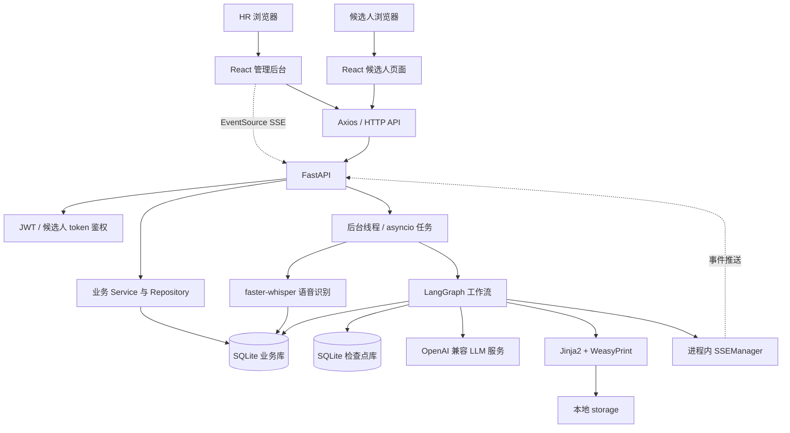
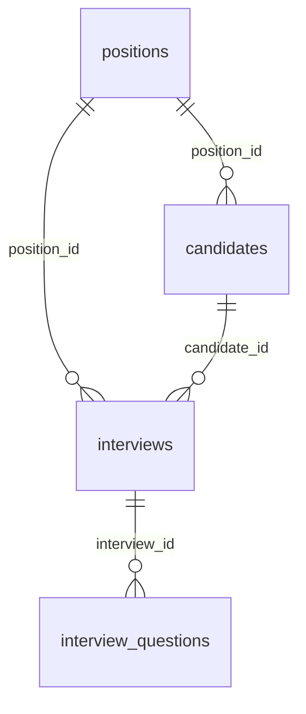
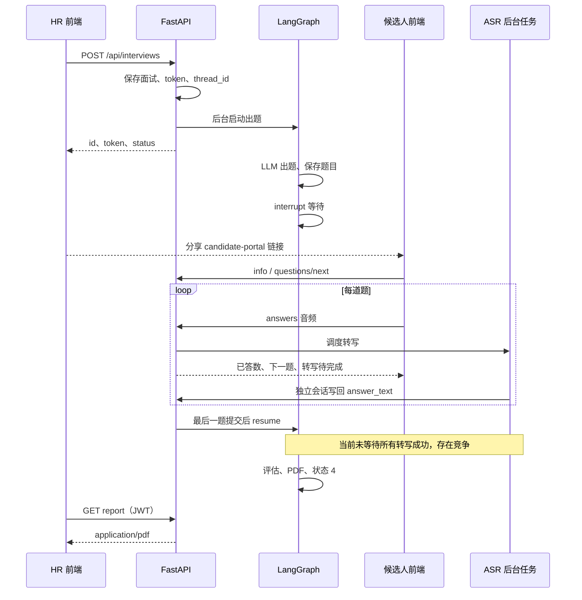

# AI 智能招聘面试系统：项目详细说明

> 分析日期：2026-11-19。本文依据当前仓库源码、依赖声明与部署配置编写，覆盖前端、后端及其协作流程。源码中的历史注释和 README 存在滞后，涉及差异时以实际执行逻辑为准。本文为静态分析结果，不代表真实 LLM、录音、邮件和生产部署已全部联调通过。

## 1. 项目定位与业务价值

这是一个面向企业 HR、招聘负责人和候选人的 AI 辅助招聘面试系统。它将岗位管理、简历入库、针对性出题、浏览器语音答题、语音转写和评估报告串联起来，减少招聘人员反复出题、整理回答和撰写评语的工作。

系统采用前后端分离架构。React 提供管理后台和候选人面试页面；FastAPI 提供业务 API；LangGraph 编排出题与评估过程；SQLite 保存业务记录及工作流检查点；本地文件系统保存录音和 PDF 等文件。

从当前实现看，项目属于以单实例部署为主的 MVP，已有完整业务链路的主要组成部分，但任务可靠性、实时事件、部署持久化及部分依赖仍需完善。不能直接将它理解为已经具备多租户、大规模并发和成熟任务队列的招聘平台。

### 1.1 使用角色

| 角色 | 主要操作 | 进入方式 |
|---|---|---|
| HR / 招聘人员 | 登录、维护岗位、上传简历、创建面试、分享面试链接、查看进度、下载报告 | `/login` 登录后进入管理后台 |
| 候选人 | 查看面试信息、听取题目、录音回答、查看答题完成提示 | `/candidate-portal?token=...` |
| 运维 / 开发人员 | 配置模型、启动服务、维护数据库与文件、排查工作流和转写问题 | 配置文件、日志、健康检查及源码 |

用户表虽然包含 `is_admin` 字段，但当前主要业务路由检查的是用户登录状态和是否启用；没有看到完整的角色权限矩阵和租户隔离实现。

### 1.2 业务流程

1. HR 创建岗位，填写岗位名称、任职要求、岗位职责与招聘人数。
2. HR 上传候选人 PDF / DOCX 简历，并将候选人关联到岗位。
3. 后台解析简历，提取文本，保存解析状态和错误信息。
4. HR 创建面试，后端生成候选人访问 token 和 LangGraph thread ID，并异步启动出题流程。
5. 工作流将岗位要求与简历文本交给 LLM，生成 10 道题及评分标准、难度标签。
6. 候选人通过链接访问面试页面，逐题录音提交；浏览器可以朗读题目。
7. 后端接收音频、更新已答数量，并在后台进行语音转写。
8. 答完全部题目后恢复工作流，进行评估并生成 PDF。
9. HR 从报告列表或面试详情下载报告，结合招聘实际情况作出判断。

第 7、8 步目前存在时序缺口：提交完全部音频会触发报告流程，但代码没有等待全部转写成功。详见第 11 节。

## 2. 总体架构



图中的 SSE 表示已有设计与代码路径，其端到端鉴权和事件结构仍有待统一。

### 2.1 技术选型与实际使用情况

| 层级 | 技术 | 当前用途与说明 |
|---|---|---|
| 前端运行框架 | React 18.3、TypeScript 5.7 | 函数组件、Hooks、类型化 API SDK |
| 前端构建 | Vite 6 | 开发服务器、API 代理、生产构建 |
| 页面路由 | React Router 7 | 管理后台嵌套路由、公开候选人页面 |
| UI 与样式 | Tailwind CSS 4、Radix UI、Lucide、Sonner | 通用交互组件、图标、通知 |
| 表单校验 | React Hook Form、Zod | 岗位表单等输入校验 |
| HTTP | Axios | JWT 注入、错误包装、401 刷新重试 |
| 声明但未见主流程接入 | TanStack Query、Recharts | 依赖存在，但当前页面主要采用 `useState + useEffect` 取数，未见 QueryClient 接入或统计图表使用 |
| Web 后端 | FastAPI、Uvicorn | API、依赖注入、请求校验、OpenAPI |
| Python | `>=3.11,<3.13` | 依赖清单明确约束的运行时范围 |
| ORM / 数据库 | SQLAlchemy 2、SQLite WAL | 同步 ORM、外键、连接与会话管理 |
| 工作流 | LangGraph、SqliteSaver | 4 个业务节点、interrupt / resume、状态持久化 |
| LLM | OpenAI Python SDK | 调用兼容接口完成结构化出题、评估 |
| 语音识别 | faster-whisper / CTranslate2 | 当前 `asr_service.py` 实际导入；与依赖清单中的 openai-whisper 不一致 |
| 中文后处理 | OpenCC（可选加载）、术语替换字典 | 繁转简与专业词修正 |
| 文件解析 | PyPDF2、python-docx | PDF 文本、DOCX 段落及表格提取 |
| 报告 | Jinja2、WeasyPrint | HTML 模板渲染与 PDF 输出 |
| 鉴权 | passlib / bcrypt、PyJWT | 当前安全模块实际使用 `jwt`，另有 python-jose 依赖声明 |
| 调度与日志 | APScheduler、structlog / 标准 logging | 周期巡检、业务及异常日志 |
| 部署 | Docker Compose、Nginx | API 容器、静态资源、HTTPS 反代与 SSE 参数 |

版本描述以依赖声明为准，实际解析版本还受 lock 文件影响。仓库依赖中出现某个框架，不等同于该框架的全部能力已经接入。

### 2.2 目录导航

```text
smart_interview_ai/
├── backend/
│   ├── app/
│   │   ├── main.py                # FastAPI 入口与生命周期
│   │   ├── config.py              # 配置加载
│   │   ├── database.py            # ORM、SQLite、会话
│   │   ├── deps.py                # HR / 候选人鉴权依赖
│   │   ├── api/                   # 6 个领域路由模块及聚合
│   │   ├── schemas/               # 请求、响应、LLM 输出模型
│   │   ├── models/                # 6 个业务表及 Repository
│   │   ├── services/              # 业务、LLM、ASR、存储、邮件、SSE
│   │   ├── workflow/              # 状态、节点、图、依赖、检查点
│   │   ├── workers/               # APScheduler 巡检
│   │   ├── core/                  # 安全、异常、日志、i18n、FFmpeg
│   │   ├── prompts/               # 出题和评估提示词
│   │   └── templates/             # 报告 HTML 与邮件模板
│   ├── tests/                     # 模型、API、服务、工作流等测试
│   ├── scripts/                   # 针对特定历史面试的数据修复脚本
│   ├── storage/                   # 运行时存储
│   ├── pyproject.toml / uv.lock
│   └── Dockerfile
├── frontend/
│   ├── src/
│   │   ├── main.tsx / App.tsx     # 应用入口、全局 Provider
│   │   ├── routes.tsx             # 路由配置
│   │   ├── pages/                 # 8 个页面组件
│   │   ├── components/            # 业务组件及 ui 原语封装
│   │   ├── api/                   # Axios 与 4 个业务 SDK
│   │   ├── contexts/              # AuthContext
│   │   ├── hooks/                 # useSSE
│   │   ├── lib/                   # 登录持久化、工具函数
│   │   ├── types/                 # 事件类型定义
│   │   └── styles/                # 全局样式
│   ├── vite.config.ts
│   └── package.json / lock 文件
├── nginx/nginx.conf
├── docker-compose.yml
├── .env.example
├── docs/
└── .zread/wiki/                    # zread 生成的分专题 Wiki
```

`backend/scripts/` 中的 `backfill_interview_4_transcripts.py`、`regen_interview_4_report.py` 针对特定面试记录，不宜当作通用数据库初始化或日常运维入口。

## 3. 前端详细说明

### 3.1 应用组织

前端入口位于 `frontend/src/main.tsx`。`App.tsx` 提供全局错误边界、登录上下文和 Sonner 通知；`routes.tsx` 决定哪些页面公开、哪些页面需要登录。HR 页面由 `AuthGuard` 保护，并置于 `AppLayout` 中统一展示导航和内容区域。

候选人页面与 HR 登录流程分开。候选人链接中的 token 指向一次面试，不需要创建 HR 用户或输入管理后台密码。

### 3.2 页面与职责

| 路由 | 页面源码 | 功能 |
|---|---|---|
| `/login` | `pages/LoginPage.tsx` | 输入账号密码、调用登录接口、保存登录态 |
| `/dashboard` | `pages/DashboardPage.tsx` | 岗位数、候选人数、面试数、报告数和最近面试 |
| `/positions` | `pages/PositionsPage.tsx` | 岗位列表、创建、编辑、删除及表单校验 |
| `/candidates` | `pages/CandidatesPage.tsx` | 候选人列表、上传简历、查看候选人详情及解析情况 |
| `/interviews` | `pages/InterviewsPage.tsx` | 面试列表、筛选与创建、进入详情 |
| `/interviews/:id` | `pages/InterviewDetailPage.tsx` | 关联候选人和岗位信息、进度、分享链接、下载报告 |
| `/reports` | `pages/ReportsPage.tsx` | 查询 `status=4` 的面试，展示结果并下载 PDF |
| `/candidate-portal?token=...` | `pages/CandidatePortalPage.tsx` | 候选人信息、题目朗读、录音提交、完成提示 |

根路径 `/` 跳转到 `/dashboard`；未知路径先跳转到根路径，再由登录守卫决定实际进入的位置。

仪表盘当前会拉取部分列表后在浏览器中计算一些指标，例如“已出报告”来自最近 10 条面试中的 `status=4` 数量，“进行中岗位”来自最多 100 条岗位数据。它们并非完整的后端全量聚合统计，因此不应直接作为精确经营报表。

### 3.3 数据访问与状态管理

`src/api/client.ts` 创建统一 Axios 实例，默认请求超时 30 秒，基础 URL 来自 `VITE_API_BASE_URL`，未设置时使用当前站点。领域 SDK 包括岗位、候选人、面试和候选人答题 API。

当前页面普遍在 `useEffect` 中发起请求，将响应保存在 `useState` 中。加载状态、表单状态、分页和刷新主要由页面自己维护。与服务器数据缓存相关的 TanStack Query 依赖虽然存在，但不能据此认为项目已经实现 Query 缓存、统一失效或自动重新获取。

认证信息保存在 localStorage 的 `interview_auth` 项中，内容包含 access token、refresh token 和用户资料。`AuthContext` 在应用启动时恢复用户信息，并提供登录、退出和认证状态。前端守卫负责界面跳转，真正访问权限由后端验证。

Axios 请求拦截器自动加入 `Authorization: Bearer <access_token>`。普通业务请求遇到 401 时，响应拦截器尝试刷新 token，然后重试一次原请求；刷新失败则清理登录态并跳转登录页。当前刷新调用使用直接的 `/api/auth/refresh` 地址，没有沿用自定义 API base URL；跨域部署时需要额外核对。

### 3.4 重要组件

| 组件 | 作用 |
|---|---|
| `AppLayout` | HR 后台的导航与整体布局 |
| `AuthGuard` | 登录状态恢复期间展示等待状态，未登录时跳转 |
| `DataTable` | 复用表格、加载、空状态与操作入口 |
| `CandidateDetailDrawer` | 展示简历文本、解析信息、错误和重新解析操作 |
| `VoiceRecorder` | 浏览器麦克风授权、MediaRecorder 录音、计时和生成 Blob |
| `QuestionReader` | SpeechSynthesis 中文题目朗读和开关 |
| `ErrorBoundary` | 捕获 React 渲染异常，避免整个页面直接白屏 |
| `ui/` | 按钮、对话框、表格、标签、选择器、抽屉等通用组件 |

候选人详情抽屉对解析状态进行轮询，约每 2 秒检查一次。接口在解析未完成时可能返回 409，抽屉还包含对该状态的处理；不能将它理解为所有简历进度都已通过 SSE 实时推送到页面。

### 3.5 语音面试体验

候选人页面从 URL 查询参数取得 token，调用面试信息接口，再获取下一道题。题目响应为 `{id, text}`；后端用 `id=0` 表示没有下一题，前端据此显示完成界面。

录音使用 `navigator.mediaDevices.getUserMedia({audio:true})` 与 `MediaRecorder`，优先选择 `audio/webm;codecs=opus`，否则尝试 `audio/webm`。停止录音后聚合为 Blob，以 multipart 上传 `question_id` 和 `audio_answer`。当前停止录音即触发提交，没有完整的预听、裁剪和确认步骤。

题目朗读使用浏览器自带 SpeechSynthesis，语言设为 `zh-CN`，不依赖后端生成语音文件。浏览器支持情况、麦克风权限和安全上下文会影响体验；真实域名部署应使用 HTTPS，localhost 开发环境可单独测试。

页面将 `status>=3` 视为答题完成。候选人看到完成提示只表示答题阶段结束，不等于转写成功或 PDF 已生成。当前页面也没有完整的等待出题轮询；过早打开链接时，应留意“尚未生成题目”与“已无下一题”的区别。

### 3.6 SSE 实时进度

`hooks/useSSE.ts` 使用原生 EventSource，提供连接状态、事件列表和 `on()` 订阅接口，出错约 3 秒后重连，组件卸载时关闭连接。面试详情订阅状态变化、答案提交和报告完成等事件。

当前联通条件尚不完备：后端 SSE 要求 Bearer header，EventSource 创建代码没有传递该 header，也没有对应的后端 cookie / query token 鉴权路径。事件在 Manager、HTTP 输出和前端消费之间还有多层 `data` 包装差异。这里应理解为“实时能力的基础实现”，实际使用前需要完成协议统一和联调。

## 4. 后端详细说明

### 4.1 分层及调用方向

后端总体遵循以下组织方式：

```text
HTTP 路由 api/
  → 请求模型 schemas/ 与依赖 deps.py
  → 业务服务 services/
  → Repository / ORM models/
  → SQLite / 本地存储

业务流程入口
  → 后台线程
  → LangGraph 节点
  → LLM / Repository / PDF / SSE
```

这种分层便于将 HTTP 协议、业务规则、数据访问和 AI 调用分别维护。但当前并非严格执行所有边界，例如候选人答题路由包含较多数据库、后台转写和审计逻辑；Repository 中也有自行提交事务的方法，不能假设所有操作都由 Service 一次性原子提交。

### 4.2 启动与关闭

`app/main.py` 在 lifespan 中依次完成：

1. 保存主 asyncio event loop，供后台线程发布事件和调度任务使用。
2. 初始化业务数据库并通过 `Base.metadata.create_all()` 建表。
3. 尝试创建默认管理用户。
4. 创建 `storage/resumes`、`audio`、`reports`、`logs` 目录。
5. 检查 FFmpeg 路径，并在线程池中预加载语音模型。
6. 启动 APScheduler 巡检任务。

关闭时停止调度器并释放语音模型。部分启动失败仅记录 warning，仍允许应用继续启动，因此 API 可以响应不代表 ASR 等能力已经就绪。

启动代码尝试创建 `admin / 123456`，但 `User.created_at` 是无默认值的必填字段，默认用户构造处未赋值；空数据库首次启动存在创建失败的静态风险，且异常会被捕获。不能保证仅启动服务就一定能用该账号登录。已有数据库还可能使用不同账号数据。

### 4.3 服务模块

| 服务文件 | 职责 |
|---|---|
| `position_service.py` | 岗位业务校验、查询和修改 |
| `candidate_service.py` | 候选人入库、简历信息、删除及关联处理 |
| `interview_service.py` | 面试创建、状态转换、删除、报告下载 |
| `workflow_service.py` | 组装初始状态、后台启动与恢复工作流、提示词渲染 |
| `llm_service.py` | OpenAI 兼容客户端、重试、JSON 解析和 Schema 校验 |
| `asr_service.py` | faster-whisper 加载、设备选择、转写与中文后处理 |
| `resume_parser_service.py` | PDF / DOCX 纯文本提取及解析异常 |
| `report_renderer.py` | 评估数据转 HTML、HTML 转 PDF |
| `file_storage.py` | 文件路径规划、原子写入、读取和删除 |
| `sse_manager.py` | 进程内按面试 ID 发布订阅 |
| `email_service.py` | 邮件模板渲染、console / SMTP 发送 |

### 4.4 请求校验与响应

Pydantic Schema 负责请求字段、响应字段与模型输出约束，常规成功响应形如：

```json
{
  "code": 0,
  "msg": "success",
  "request_id": "自动生成的 UUID",
  "data": {}
}
```

列表结果在 `data` 中包含 `items`、`total`、`page` 和 `page_size`。文件下载直接返回二进制内容，SSE 返回事件流，不使用该 JSON 包装。

`APIError` 经全局处理器转为业务错误响应；未捕获异常转换为 500。未看到为 FastAPI 默认请求验证错误单独定义统一处理器，因此不要假定所有 422 校验失败也都具有同样的 `code/msg/data` 结构。`request_id` 目前由响应模型生成，也不等于已经实现了贯穿所有任务与日志的完整链路追踪。

### 4.5 认证机制

HR 使用 JWT，access token 默认有效 24 小时，refresh token 默认有效 7 天。安全模块验证签名、有效期和 token 类型；依赖层还检查用户存在且启用。密码使用 passlib / bcrypt 哈希保存。

候选人使用默认 32 位字母数字随机 token。后端根据 `interviews.token` 查找面试，再限制提交的问题必须属于该面试。目前查找逻辑没有基于时间的有效期判断或独立撤销字段；错误文案中的“已过期”不能作为已经实现到期控制的证据。

## 5. 数据模型与存储

### 5.1 六张业务表

| 表 | 主键 | 核心信息 |
|---|---|---|
| `users` | 字符串 ID | 账号、邮箱、密码哈希、启用状态、管理员标记、登录时间 |
| `positions` | 整数自增 ID | 岗位名称、要求、职责、人数、状态、招聘人 |
| `candidates` | 字符串 ID | 岗位关联、姓名邮箱、简历类型与内容、解析状态、文本和错误 |
| `interviews` | 整数自增 ID | 候选人 / 岗位关联、时间、状态、答题计数、token、thread ID、报告 |
| `interview_questions` | 整数自增 ID | 所属面试、题目、评分标准、难度、音频、转写文本、回答时间 |
| `audit_logs` | 整数自增 ID | 事件类型、操作者、关联对象、JSON 元数据、发生时间 |



审计日志中的关联 ID 用于定位事件，不都声明为数据库外键；`uploaded_by` 等字段也不应自动理解为具备 ORM 关系或外键约束。

### 5.2 状态定义

| 对象 | 状态 |
|---|---|
| 岗位 `status` | 0 未启动、1 进行中、2 已完成 |
| 简历 `parse_status` | 0 待解析、1 解析中、2 成功、3 失败 |
| 面试 `status` | 0 未开始、1 试题已备好、2 进行中、3 作答完毕、4 报告已生成 |

面试通常沿 `0 → 1 → 2 → 3 → 4` 推进。Service 的人工更新接口另允许部分跳转，如 `0→4`、`1→3/4`。候选人信息 GET 还会将状态 0 改为 1，即使题目尚未完成，因此状态 1 在当前实现中不能单独证明题目已经可用，应结合 `question_count` 和题目记录判断。

### 5.3 数据库与文件位置

业务库默认 `sqlite:///./interview.db`，相对路径依赖后端进程的工作目录。SQLAlchemy 连接启用 WAL、外键和 5 秒 busy timeout。WAL 改善读写并发，但不会消除 SQLite 单写者限制。

工作流检查点另存 SQLite。当前 `get_checkpointer_sync()` 按源码路径计算，实际指向 `backend/app/workflow_checkpoints.db`；仓库中还存在 `backend/workflow_checkpoints.db`。主流程应以同步获取器的实际路径为准，不能看到根级同名文件就认定它是当前运行库。

文件存储路径约定：

```text
storage/resumes/{candidate_id}/original.pdf 或 original.docx
storage/audio/{interview_id}/{question_id}.webm
storage/reports/{interview_id}.pdf
```

`LocalFileStorage` 采用临时文件写入、flush / fsync、`os.replace` 替换的方式降低半写入风险。但不是所有业务路径都已完全改为文件存储：当前上传简历主要保存在 `resume_content` BLOB；音频接收时先保存 BLOB，再由后台任务写文件；报告主要写文件，同时下载接口兼容旧 BLOB。

数据库中仍保留文件路径和二进制字段，属于存储方式演进中的兼容设计。备份应同时考虑业务库、实际检查点库及 storage，SQLite 在线备份应使用一致性备份方式，避免只复制主文件而忽略 WAL。

### 5.4 六张表的字段设计

以下字段字典依据 `backend/app/models/` 的 SQLAlchemy 声明整理，描述的是源码模型，不是对当前运行数据库执行反向工程后的结果。类型使用 ORM 类型名称：`String` 对应字符串，`Text` 对应长文本，`Integer` 对应整数，`Boolean` 对应布尔值，`LargeBinary` 对应 BLOB。

“可空”表示模型是否允许 NULL。“默认”主要是 SQLAlchemy 在应用写入时提供的默认值，不代表通过原生 SQL 插入时数据库也一定会补值。时间字段采用秒级整数时间戳；下表中的“当前时间”指代码生成的时间值。

#### 5.4.1 `users`：HR 用户表

| 字段 | 类型 | 可空 | 约束 / 默认 | 用途 |
|---|---|---|---|---|
| `id` | String | 否 | 主键，调用方提供 | 用户唯一标识 |
| `username` | String | 否 | 唯一，索引 | 登录账号 |
| `email` | String | 否 | 唯一 | 用户邮箱 |
| `password_hash` | String | 否 | 无默认 | bcrypt 密码哈希 |
| `full_name` | String | 是 | 无默认 | 用户姓名 |
| `is_active` | Boolean | 否 | 默认 true | 是否允许登录 |
| `is_admin` | Boolean | 否 | 默认 false | 管理员标记 |
| `created_at` | Integer | 否 | 模型无默认，Repository 创建时赋值 | 创建时间 |
| `last_login_at` | Integer | 是 | 无默认 | 最近登录时间 |

该表负责 HR 身份，不保存候选人账号。用户名、邮箱不能重复；密码保存哈希。当前没有单独的角色表、权限表、用户角色关联表，因此 `is_admin` 不等于已经实现完整 RBAC。

源码：[用户模型](../backend/app/models/user.py)。

#### 5.4.2 `positions`：招聘岗位表

| 字段 | 类型 | 可空 | 约束 / 默认 | 用途 |
|---|---|---|---|---|
| `id` | Integer | 否 | 自增主键 | 岗位 ID |
| `name` | String | 否 | 索引 | 岗位名称 |
| `requirements` | Text | 否 | 默认空字符串 | 任职要求，供 AI 出题 |
| `responsibilities` | Text | 否 | 默认空字符串 | 岗位职责，供 AI 出题 |
| `quantity` | Integer | 否 | 默认 1 | 招聘人数 |
| `status` | Integer | 否 | 默认 0 | 0 未启动 / 1 进行中 / 2 已完成 |
| `recruiter` | String | 是 | 无外键 | 招聘人用户名 |
| `created_at` | Integer | 否 | 默认当前时间 | 创建时间 |
| `updated_at` | Integer | 否 | 默认当前时间，配置 ORM 更新时刷新 | 更新时间 |

一条岗位可关联多个候选人和多次面试。`recruiter` 是普通字符串，数据库不会验证其一定存在于 `users`，用户改名时也不会自动同步。

源码：[岗位模型](../backend/app/models/position.py)。

#### 5.4.3 `candidates`：候选人与简历表

| 字段 | 类型 | 可空 | 约束 / 默认 | 用途 |
|---|---|---|---|---|
| `id` | String | 否 | 主键，调用方提供 | 候选人 ID，业务创建时使用 UUID |
| `position_id` | Integer | 否 | 外键 `positions.id`，索引 | 所属应聘岗位 |
| `name` | String | 否 | 索引 | 候选人姓名 |
| `email` | String | 否 | 普通索引，不唯一 | 候选人邮箱 |
| `resume_type` | Integer | 否 | 无默认 | 0 PDF / 1 Word，当前支持 DOCX |
| `resume_content` | LargeBinary | 是 | 无默认 | 原始简历二进制 |
| `resume_path` | String | 是 | 无默认 | 简历文件路径，兼容文件存储方案 |
| `resume_text` | Text | 是 | 无默认 | 解析后的简历纯文本 |
| `parse_status` | Integer | 否 | 模型默认 0，Repository 创建时设为 1 | 0 待解析 / 1 解析中 / 2 成功 / 3 失败 |
| `parse_error` | String | 是 | 无默认 | 解析失败原因 |
| `is_scanned_document` | Boolean | 否 | 默认 false | 扫描文档标识 |
| `parsed_at` | Integer | 是 | 无默认 | 解析处理时间 |
| `uploaded_by` | String | 否 | 无外键 | 上传 HR 的用户 ID |
| `uploaded_at` | Integer | 否 | 默认当前时间 | 上传时间 |
| `created_at` | Integer | 否 | 默认当前时间 | 创建时间 |
| `updated_at` | Integer | 否 | 默认当前时间，配置 ORM 更新时刷新 | 更新时间 |

把原件、提取文本和解析状态放在同一条记录中，便于后台任务更新、前端查询及后续 AI 出题。邮箱没有唯一约束，因此同一邮箱可以对应多条候选人记录。

当前 `position_id` 直接放在候选人表，意味着一条候选人记录只归属一个岗位。若要支持统一人才库及同一人多岗位投递，可拆成 `candidates` 人才档案与 `applications` 岗位申请表，再让面试关联申请记录；这是后续设计建议，当前没有该申请表。

源码：[候选人模型](../backend/app/models/candidate.py)。

#### 5.4.4 `interviews`：面试主表

| 字段 | 类型 | 可空 | 约束 / 默认 | 用途 |
|---|---|---|---|---|
| `id` | Integer | 否 | 自增主键 | 一次面试的 ID |
| `candidate_id` | String | 否 | 外键 `candidates.id`，索引 | 被面试候选人 |
| `position_id` | Integer | 否 | 外键 `positions.id`，索引 | 本次面试对应岗位 |
| `interviewer` | String | 是 | 无外键 | 面试官姓名或说明 |
| `start_time` | Integer | 否 | 模型无默认，Service 可补当前时间 | 安排的开始时间 |
| `end_time` | Integer | 是 | 无默认 | 作答结束时间 |
| `status` | Integer | 否 | 默认 0，索引 | 面试状态 0–4 |
| `question_count` | Integer | 是 | 出题完成后赋值 | 总题数，NULL 表示尚未记录 |
| `answered_count` | Integer | 否 | 默认 0 | 已接收回答数量 |
| `total_hard_questions` | Integer | 否 | 默认 0 | 难题数量 |
| `total_medium_questions` | Integer | 否 | 默认 0 | 中等题数量 |
| `total_easy_questions` | Integer | 否 | 默认 0 | 简单题数量 |
| `is_passed` | Integer | 是 | 无默认 | 是否通过，当前 0 / 1，未出结果可为 NULL |
| `voice_reading` | Integer | 否 | 默认 1 | 0 关闭 / 1 开启题目朗读 |
| `report_content` | LargeBinary | 是 | 无默认 | 旧报告 BLOB，下载时兼容 |
| `report_path` | String | 是 | 无默认 | 当前生成的 PDF 路径 |
| `token` | String | 否 | 唯一，索引，Repository 生成 | 候选人访问凭证，默认 32 位 |
| `langgraph_thread_id` | String | 否 | 唯一，默认 UUID 字符串 | 对应工作流检查点线程 |
| `created_at` | Integer | 否 | 默认当前时间 | 创建时间 |
| `updated_at` | Integer | 否 | 默认当前时间，配置 ORM 更新时刷新 | 更新时间与巡检依据 |

该表是招聘流程中的中心记录。候选人可以有多次面试，各自拥有不同 token、工作流线程、题目和报告。

`question_count`、`answered_count` 与难度数量属于冗余汇总，便于列表快速显示；题目表才保存逐题明细。写入时需要保持两者一致。`token` 负责访问鉴权，`langgraph_thread_id` 负责流程恢复，两者不能混用。

面试中额外保存 `position_id` 可直接按岗位查询，不必每次经过候选人表，但目前两个独立外键只保证候选人和岗位各自存在，不保证 `interviews.position_id` 与该候选人的 `position_id` 相同。

当前没有独立 `reports` 表，报告路径和结果直接附属于面试。若要支持重新评估、评分模型版本、人工复核和历史报告，应考虑独立报告 / 评估结果表。

源码：[面试模型](../backend/app/models/interview.py)。

#### 5.4.5 `interview_questions`：题目与答案表

| 字段 | 类型 | 可空 | 约束 / 默认 | 用途 |
|---|---|---|---|---|
| `id` | Integer | 否 | 自增主键 | 题目 ID |
| `interview_id` | Integer | 否 | 外键 `interviews.id`，索引 | 所属面试 |
| `question` | Text | 否 | 无默认 | 题目正文 |
| `score_standard` | Text | 是 | 无默认 | 单题评分标准 |
| `difficulty` | String | 否 | 默认 `medium` | hard / medium / easy |
| `answer_audio` | LargeBinary | 是 | 无默认 | 答题录音 BLOB |
| `answer_audio_path` | String | 是 | 无默认 | 音频文件路径 |
| `answer_text` | Text | 是 | 无默认 | ASR 转写文本 |
| `created_at` | Integer | 否 | 默认当前时间 | 题目创建时间 |
| `answered_at` | Integer | 是 | 无默认 | 回答时间，未答时为 NULL |

当前每道题只保存一份答案，没有独立题库表或答案表。AI 生成的题目直接属于某一次面试，适合针对岗位和简历生成个性化题目。若需要多次作答、追问、录音重传和答案版本，可将回答拆为独立表。

当前按 ID 升序取下一道未答题，没有单独的题目序号字段。需要支持题目重排时可增加 `sequence_no` 并建立 `(interview_id, sequence_no)` 唯一约束。

`answered_at` 非 NULL 代表已接收回答，不等于 `answer_text` 已完成转写；而且转写写回方法还会再次更新 `answered_at`。未来可拆分 `submitted_at`、`transcribed_at`，新增 `transcription_status` 和错误字段，避免把提交进度与转写进度混为一谈。

源码：[题目模型](../backend/app/models/interview_question.py)。

#### 5.4.6 `audit_logs`：审计日志表

| 字段 | 类型 | 可空 | 约束 / 默认 | 用途 |
|---|---|---|---|---|
| `id` | Integer | 否 | 自增主键 | 日志 ID |
| `event_type` | String | 否 | 索引 | 事件类型，如 `answer_transcribed` |
| `interview_id` | Integer | 是 | 普通索引，无外键 | 关联面试 |
| `candidate_id` | String | 是 | 普通索引，无外键 | 关联候选人 |
| `user_id` | String | 是 | 普通索引，无外键 | 关联 HR 用户 |
| `actor_id` | String | 是 | 无默认 | 实际操作或触发者 ID |
| `actor_type` | String | 否 | 默认 `user` | user / candidate / system |
| `metadata_json` | Text | 否 | 默认字符串 `{}` | JSON 编码的扩展信息 |
| `occurred_at` | Integer | 否 | 默认当前时间，索引 | 事件发生时间 |

关联资源表示“事情发生在哪个对象上”，行为者表示“是谁触发的”。例如候选人提交答案时，`interview_id` 指面试，`actor_id` 指候选人，元数据中可保存题目 ID 和录音大小。

关联 ID 不声明外键，因此数据库不会强制要求对应资源仍存在，也不会在删除资源时自动删日志。`metadata_json` 是普通 Text，而非单独拆分的业务列。Repository 虽能按元数据查询幂等键，但没有数据库唯一约束保证并发幂等。

源码：[审计模型](../backend/app/models/audit_log.py)。

### 5.5 关联、索引与约束如何工作

当前数据库实际声明的业务外键共 4 处：

| 外键字段 | 目标字段 | 业务关系 |
|---|---|---|
| `candidates.position_id` | `positions.id` | 一个岗位对应多个候选人 |
| `interviews.candidate_id` | `candidates.id` | 一个候选人对应多次面试 |
| `interviews.position_id` | `positions.id` | 一个岗位对应多次面试 |
| `interview_questions.interview_id` | `interviews.id` | 一次面试对应多道题目 |

SQLite 连接设置 `foreign_keys=ON`，使外键约束真正生效。模型未配置 `ON DELETE CASCADE`，也未启用完整 ORM relationship 级联，因此不能依靠数据库自动删除子记录；业务代码需要先处理题目、面试等关联数据，再删除父记录。

显式唯一规则包括 `users.username`、`users.email`、`interviews.token`、`interviews.langgraph_thread_id`，以及各表主键。`candidates.email`、岗位名称、面试题正文都没有唯一约束。唯一约束与普通查询索引的作用不同：前者防止重复值，后者主要改善查询性能。

现有显式查询索引以单列为主，围绕用户名、岗位名称、关联 ID、状态、token、审计事件和时间建立。随着数据量增长，可根据实际查询计划考虑 `(position_id, status)`、`(interview_id, answered_at, id)`、`(interview_id, occurred_at)` 等联合索引；这些是候选方案，当前模型尚未声明。

状态编码、人数、难度和布尔型整数的取值主要由应用层校验，模型没有为它们声明 `CheckConstraint`。例如数据库本身没有 CHECK 保证 `status` 必须是 0–4，也没有 CHECK 保证 `answered_count <= question_count`。涉及关键业务不变量时，应结合迁移增加数据库约束。

### 5.6 LangGraph 检查点库的设计

除 6 张业务表外，`SqliteSaver` 在独立的检查点数据库中维护框架表。当前安装的框架实现包含 `checkpoints` 和 `writes`，用于持久化图状态、中间写入和恢复所需信息；具体字段及序列化格式由 LangGraph 管理。

业务与检查点的连接方式是：

```text
interviews.id
  → interviews.langgraph_thread_id
  → SqliteSaver 的 thread_id
  → 当前图状态、等待节点、检查点及中间写入
```

该关联是跨库的逻辑关联，没有跨库外键。业务状态回答“面试进行到哪一步”，检查点回答“工作流如何从暂停位置继续运行”。只备份其中一个库，可能保留面试记录却丢失流程恢复信息。

检查点文件位置以第 5.3 节说明的同步运行路径为准。框架表不应由业务代码随意修改，也不应误计入 6 张招聘业务表中。

### 5.7 一次面试中的数据库读写顺序

1. HR 创建岗位，写入 `positions`。
2. 上传简历，写入 `candidates` 的基本信息和简历 BLOB，将解析状态设为处理中。
3. 后台解析简历，更新 `resume_text`、`parse_status`、错误和解析时间，并按执行路径记录审计事件。
4. 创建面试，写入 `interviews`，生成独立 token 和工作流 thread ID。
5. 工作流读取岗位、候选人，生成题目，批量写入 `interview_questions`，更新面试总题数与难度计数；检查点库保存等待位置。
6. 每次提交回答，更新题目音频和回答时间，增加面试已答数量；后台转写完成后写回 `answer_text`。
7. 全部音频提交后恢复工作流，读取题目与答案，生成报告文件，更新 `interviews.report_path`、`is_passed` 与状态 4。
8. HR 查询面试并下载报告，PDF 主要从文件路径读取，兼容旧 BLOB。

当前多个 Repository 自行 commit，审计 Repository 也会提交事务，所以这些步骤不能视为一整个原子事务。音频提交、后台转写、文件生成和工作流推进之间还跨线程、跨库、跨文件系统，需以明确状态和幂等机制保证最终一致性。

### 5.8 设计取舍与演进方向

| 当前取舍 | 适用原因 | 后续演进方向 |
|---|---|---|
| SQLite 单机业务库 | 部署简单，适合 MVP | 并发和多实例需求增长后评估 PostgreSQL |
| 候选人与岗位直接关联 | 减少表数量，简化岗位内招聘流程 | 拆人才档案与投递申请，支持一人多投 |
| 题目与单份答案合表 | 逐题作答流程简单 | 拆回答表，支持补答、追问和版本 |
| 报告直接附属于面试 | 获取与下载方便 | 拆评估结果 / 报告版本表，保存结构化分数与模型版本 |
| 冗余保存进度和难度数 | 列表展示成本低 | 增加一致性校验和原子更新策略 |
| BLOB 与文件路径并存 | 兼容旧数据与存储迁移 | 统一主存储方式，完善文件清理与备份 |
| 普通字符串记录招聘人和上传者 | 实现成本低 | 按用户生命周期要求补外键或历史快照规则 |
| 应用控制状态转换 | 业务规则易于调整 | 对关键不变量增加 CHECK / UNIQUE 等数据库保护 |
| `create_all()` 建表 | 开发初始化简单 | 落实 Alembic 版本迁移，处理已有库升级 |

其中最直接影响当前链路的改进，是增加明确的转写状态并以“全部转写处理完成”作为生成报告的前置条件，以及统一业务更新、进度计数和审计记录的事务边界。以上均是分析建议，本次文档更新不修改数据库结构或现有数据。

## 6. AI 与工作流实现

### 6.1 LangGraph 四节点

源码入口为 `workflow/graph.py`，节点在 `workflow/nodes.py`，依赖由 `WorkflowDeps` 提供。


| 节点 | 输入与动作 | 输出 |
|---|---|---|
| `generate_questions` | 读取岗位和简历，渲染出题 Prompt，调用 LLM，批量保存题目 | 题目、题数、难度分布，面试状态 1 |
| `wait_for_candidate` | 通过 `interrupt()` 持久化等待点 | 恢复后写入已答数量 |
| `validate_complete` | 从数据库核对答题数，未齐全时再次 interrupt | 已答数与待答状态 |
| `generate_report` | 读取问答及评分标准，调用评估模型，渲染 PDF | 报告路径、结果，面试状态 4 |

`langgraph_thread_id` 将一次面试与检查点关联。创建接口使用后台线程启动工作流；最后一题提交后通过 `Command(resume=...)` 恢复。interrupt 是工作流的持久化暂停点，不是持续占用一个 HTTP 连接等待候选人。

依赖注入使节点可以替换 Repository、文件存储和 SSE 等依赖。不过节点内仍直接导入 `chat_json`，测试 LLM 时还需要 patch 对应调用，不能认为所有外部调用都完全通过容器注入。

图目前是线性连边，没有围绕 `error/error_node` 配置独立错误分支。节点返回错误状态并不等于自动中止整张图或进入统一补偿流程。

### 6.2 出题与模型输出约束

`prompts/question_generation.v1.j2` 将岗位名称、任职要求、岗位职责和简历文本送入模型。简历为空时有按 JD 出题的兜底文案。

`QuestionList` 要求恰好 10 题，每题包含题目、评分标准和 `hard / medium / easy` 难度。`chat_json()` 请求 JSON 对象输出，解析 JSON，必要时提取 Markdown 代码块，再通过 Pydantic 校验。

LLM 连接真正由 `OPENAI_API_KEY`、`OPENAI_BASE_URL` 和 `LLM_MODEL` 决定；`LLM_PROVIDER` 只是已有配置字段，当前客户端并未为每个 provider 实现独立工厂逻辑。切换厂商时应同步核对兼容接口地址和模型名。

429、超时与 5xx 使用指数退避重试，其他 API 4xx 直接抛出。默认最多尝试 3 次；JSON 解析或 Schema 校验失败不属于这一层自动修复重试范围。

当 key 恰为代码中的默认占位值时，出题会返回内置模拟题。模拟函数只支持 `QuestionList`，不支持 `ReportEvaluation`，因此没有真实 key 时不能依靠此模式完成完整的自动评估链路。

### 6.3 简历解析

上传接口通过 PDF / ZIP 文件头初步识别类型，最大允许 50MB。DOCX 是 ZIP 容器，ZIP 文件头检查只是初筛，具体解析时还可能失败。

PDF 使用 PyPDF2 按页提取文本；DOCX 使用 python-docx 提取段落和表格。解析在后台执行，成功后写入简历文本与时间，失败后记录原因。扫描 PDF 会被识别为缺少可提取文本，当前没有 OCR 识别链路。

重新解析接口可以利用已保存简历再次发起任务；它不是重新上传文件，也不能自动解决扫描件或损坏文件本身的问题。

### 6.4 语音识别

`asr_service.py` 当前使用 `from faster_whisper import WhisperModel`。设备配置为 `auto` 时优先 CUDA、否则 CPU；CPU 使用 int8，GPU 使用 float16。转写启用 VAD、beam search，并提供中文面试专业术语 initial prompt。

转写结果先进行术语字典替换，再尝试 OpenCC 繁转简。OpenCC 不可用时会保留原文本。术语替换属于规则修正，会影响输出文本，不能等同于人工校对后的逐字转录。

接口接收音频后立即返回，`transcription_pending=true` 表示仍在转写。后台任务将结果写回 `interview_questions.answer_text`，并记录 `answer_transcribed` 或 `answer_transcribe_failed` 审计事件。

代码虽提供 `WHISPER_TIMEOUT_SECONDS` 和转写超时参数，但当前 faster-whisper 调用没有实现对应的硬超时取消机制。

### 6.5 评估报告

评估输入为题目、评分标准和转写答案。输出包括单题 0–10 分、技术能力 0–100 分、沟通能力 0–100 分、综合评分、综合评语和录用建议。综合维度中模型偶发返回的小数会先取整再校验。

`report_renderer.py` 用 `templates/report.html` 渲染 HTML，再由 WeasyPrint 生成 PDF。工作流将综合分 `>=60` 写为 `is_passed=1`，否则为 0。这是当前固定规则，尚不是可配置的岗位评分策略。

报告与面试共用 ID 和存储关联，未单独创建 `reports` 表。详细评估主要进入 PDF，审计元数据记录综合分；当前不是一套独立版本化的评估结果数据模型。

### 6.6 巡检、邮件与国际化

APScheduler 每 5 分钟检查状态 1、2、3 且 30 分钟未更新的面试，尝试读取检查点并恢复。该机制是尽力恢复，不是具有重试次数、租约、死信和分布式锁的任务队列；恢复时传入 `None` 的路径还需要与节点的 payload 使用方式共同验证。

邮件服务已有邀请和报告就绪模板，支持 console / SMTP 分支，但默认 backend 固定为 console。创建面试会调用邀请服务，邀请链接仍写死为 `http://localhost:5173`。存在报告通知辅助函数不表示报告节点已经调用它。

`core/i18n.py` 与 `i18n/zh.json`、`en.json` 提供后端文案基础；前端与部分后端文案仍直接使用中文，不能据此认为系统已有完整的双语切换体验。

## 7. 前后端接口与协作

### 7.1 接口清单

下表根据当前路由装饰器整理。普通 HR 业务及 SSE 需要 JWT；候选人四个接口通过路径 token 验证。登录和刷新不需要已有 access token。

| 方法 | 路径 | 用途 |
|---|---|---|
| POST | `/api/auth/login` | 账号密码换取 token 与用户资料 |
| POST | `/api/auth/refresh` | 通过 query 参数 `refresh_token` 换取新 token |
| GET / POST | `/api/positions` | 岗位分页列表 / 创建 |
| GET / PUT / DELETE | `/api/positions/{position_id}` | 岗位详情 / 更新 / 删除 |
| GET / POST | `/api/candidates` | 候选人分页列表 / multipart 上传简历 |
| GET / DELETE | `/api/candidates/{candidate_id}` | 候选人详情 / 删除 |
| GET | `/api/candidates/{candidate_id}/resume` | 下载原始简历内容 |
| GET | `/api/candidates/{candidate_id}/resume-text` | 查询解析文本、状态、错误；未完成时为 409 |
| POST | `/api/candidates/{candidate_id}/reparse` | 重新解析已存简历 |
| GET / POST | `/api/interviews` | 面试分页筛选 / 创建并触发工作流 |
| GET / PUT / DELETE | `/api/interviews/{interview_id}` | 面试详情 / 更新 / 删除 |
| GET | `/api/interviews/{interview_id}/report` | 下载 PDF |
| GET | `/api/interviews/{interview_id}/events` | SSE 事件流 |
| GET | `/api/candidate/{token}/info` | 候选人面试信息，含状态更新和补触发出题逻辑 |
| GET | `/api/candidate/{token}/questions/next?after=0` | 按题 ID 获取下一题 |
| POST | `/api/candidate/{token}/answers` | multipart 提交题目 ID 与录音 |
| PATCH | `/api/candidate/{token}/preferences` | 设置 `enabled` 控制题目朗读偏好 |
| GET | `/healthz` | 存活检查 |
| GET | `/readyz` | 数据库、存储和磁盘空间检查 |

候选人 API 的实际前缀是 `/api/candidate`，不是历史文档中的 `/api/candidate_portal`。分页常见上限为每页 100 条；面试列表支持候选人、岗位和状态筛选。服务层部分 `total` 通过最多读取 10000 条记录再取长度计算，大数据量时需要改为数据库 COUNT。

### 7.2 创建面试到下载报告



报告下载由 Axios 以 Blob 获取，从而携带 JWT；前端创建临时 object URL 触发保存，随后释放 URL。直接在新标签打开受保护的报告 URL 不会自动附带 localStorage 中的 Bearer token。

## 8. 配置与本地运行

### 8.1 主要配置

| 配置项 | 用途 / 默认行为 |
|---|---|
| `ENV`、`LOG_LEVEL` | 环境标记和日志级别 |
| `DATABASE_URL` | 默认工作目录下 `interview.db` |
| `STORAGE_PATH` | 默认 `./storage` |
| `OPENAI_API_KEY` | LLM 密钥，使用部署者自己的值 |
| `OPENAI_BASE_URL`、`LLM_MODEL` | 兼容服务地址和模型名 |
| `LLM_TEMPERATURE` | 默认 0.1 |
| `LLM_TIMEOUT_SECONDS`、`LLM_MAX_RETRIES` | 默认 60 秒、最多尝试 3 次 |
| `JWT_SECRET_KEY`、`JWT_ALGORITHM` | JWT 签名配置 |
| `JWT_ACCESS_TOKEN_EXPIRE_HOURS` | 默认 24 小时 |
| `JWT_REFRESH_TOKEN_EXPIRE_DAYS` | 默认 7 天 |
| `CORS_ORIGINS` | 允许的前端来源列表 |
| `WHISPER_MODEL`、`WHISPER_DEVICE` | 默认 base / auto |
| `VITE_API_BASE_URL` | 前端构建时的 API 基础地址，默认同源 |

后端 Settings 明确重写配置优先级：构造参数 > 当前工作目录 `.env` > 系统环境变量 > secrets 文件 > 默认值。这与许多项目“环境变量覆盖 .env”的习惯不同。

因此，从 `backend/` 启动时，默认查找的是 `backend/.env`，不会自动向上查找根 `.env`。根级 `.env` 在 Docker Compose 中用于变量替换，与本地后端配置读取不是同一过程。本文不包含工作区真实 `.env` 的内容。

### 8.2 后端开发启动

在项目根目录使用 PowerShell：

```powershell
# 若 backend/.env 尚不存在，可复制根模板后自行填写配置
Copy-Item .env.example backend/.env
Set-Location backend
uv sync
uv run uvicorn app.main:app --host 0.0.0.0 --port 8000 --reload
```

上述复制步骤只适用于尚无配置文件的新环境，已有配置时应保留原文件。当前依赖清单没有声明实际 ASR 使用的 `faster-whisper`，所以仅 `uv sync` 不能保证语音识别可用；还需统一并锁定 faster-whisper 及可选 OpenCC 依赖。FFmpeg、WeasyPrint 所需系统库、中文字体和模型缓存也应准备好。

首次启动会尝试初始化表，单独执行 `init_db()` 只负责建表，不会修复旧表结构或完整初始化用户。可通过 `http://localhost:8000/docs`、`/redoc` 查看实际 API 文档，通过 `/healthz` 和 `/readyz` 查看基础状态。当前 `/readyz` 的 `ready=false` 位于 JSON 内，HTTP 状态仍可能为 200，监控应解析响应数据。

### 8.3 前端开发启动

另开终端，从项目根目录运行：

```powershell
Set-Location frontend
pnpm install
pnpm dev
```

访问 `http://localhost:5173`。Vite 固定使用 5173，端口占用时直接失败；开发环境将 `/api` 请求代理到 `http://localhost:8000`。局域网候选人访问需要同时考虑麦克风的 HTTPS 限制，不能仅确认页面能打开。

当前同时存在 npm 和 pnpm lock 文件。团队应明确使用一种包管理器维护依赖，避免两份锁定结果漂移。

## 9. Docker 与生产部署说明

`docker-compose.yml` 定义两个服务：`api` 使用后端 Dockerfile 构建，`nginx` 提供前端静态页面和 API 反向代理。前端不会在 Compose 中自动构建，需要事先生成 `frontend/dist`。

基本准备顺序：

1. 统一后端依赖，准备真实 LLM / JWT 配置。
2. 构建前端：在 `frontend/` 运行 `pnpm build`。
3. 替换 Nginx 中的域名、证书和私钥路径。
4. 准备可写 storage、正确的 SQLite 文件挂载及实际检查点库持久化。
5. 在根目录执行 `docker compose up -d --build`，检查容器日志和健康状态。
6. 使用真实域名验证登录、上传、录音、转写、报告和 SSE。

Nginx 对 SPA 使用 `try_files ... /index.html`，使刷新子路由仍可进入 React。普通 `/api/` 转发到 API 容器，上传限制为 50M；面试 SSE 路径单独关闭缓冲与缓存，并延长读写超时到 1 小时。

当前配置有几个必须理解的边界：

| 项目 | 当前情况 |
|---|---|
| HTTPS | 仍使用 `your-domain.com` 和示例证书文件名，直接照抄无法完成生产部署 |
| 业务库挂载 | 挂载单个 `interview.db` 文件，需确认源文件存在、权限及 WAL 伴随文件的持久化方式 |
| 检查点库 | 同步运行时位于 `/app/app/workflow_checkpoints.db`，当前 Compose 未显式持久化该路径 |
| 前端资源 | 宿主机 `frontend/dist` 挂载给 Nginx；没有构建产物时无法正常提供页面 |
| 模型缓存 | Compose 未单独挂载模型缓存，重建可能重复下载 |
| 中文 PDF | Dockerfile 未显式安装中文字体包，需要实际验证中文字符显示 |
| 扩容 | SSE、后台任务、调度器、部分单例状态都在进程内，不能直接加 workers 就视为完成水平扩展 |

目前更适合单 API 进程部署。扩展到多实例前，应明确共享任务队列、跨进程事件总线、分布式调度控制、数据库与文件存储策略。

## 10. 测试、验证与开发维护

后端已有 smoke、模型、API、服务、工作流、集成、简历解析、PDF、邮件和 i18n 测试。部分测试 mock 外部模型或数据库依赖；真实语音和部分完整工作流测试存在显式跳过。旧 README 中的“89 passed + 2 skipped”是历史陈述，本文不将它当作本次执行结果。

前端 package scripts 提供开发、构建、类型检查和 lint，未看到独立的前端单元测试 / E2E 测试脚本。ESLint 9 依赖虽然存在，也需要确认配置文件和规则实际可运行。

建议的开发检查命令：

```powershell
# backend/ 内
uv run pytest
uv run ruff check app tests

# frontend/ 内
pnpm type-check
pnpm build
pnpm lint
```

以上是维护命令，不是本次已通过的测试清单。涉及测试数据库、检查点和模型加载的测试，应先确认 fixture 隔离，避免误操作正在运行的数据。

新增业务功能时建议按以下链路修改：模型 / Repository → Schema → Service → API → 前端领域 SDK → 页面 / 组件 → 权限与错误处理 → 测试与文档。涉及状态变化时，应同时核对工作流、审计、SSE 和 UI 状态映射。

## 11. 已确认的实现差异与改进优先级

本节记录静态分析发现，不表示已在本次任务中修改业务代码。优先级按对现有链路的影响建议排序。

| 优先级 | 发现 | 影响与建议 | 主要定位 |
|---|---|---|---|
| 高 | ASR 源码使用 faster-whisper，依赖仍声明 openai-whisper | 新环境安装后可能缺少实际导入模块；同步依赖与锁文件 | `services/asr_service.py`、`pyproject.toml` |
| 高 | 最后一题接收后直接恢复评估，未等待所有转写完成 | 评估可能将尚未转写的答案当成未回答；增加独立转写完成状态和报告就绪门槛 | `api/candidate_portal.py`、`workflow/nodes.py` |
| 高 | 默认管理员构造缺少必填 `created_at` | 空库可能无可登录用户，启动异常又被忽略；补齐初始化流程并测试空库启动 | `main.py`、`models/user.py` |
| 高 | 原生 EventSource 未携带后端要求的 Bearer header | HR 实时进度可能持续 401；统一 SSE 鉴权方案 | `hooks/useSSE.ts`、`api/events.py`、`deps.py` |
| 高 | SSE payload 多层包装且消费字段未同步 | 页面读不到预期的状态或计数；明确一层 event/data 契约 | `sse_manager.py`、`api/events.py`、`InterviewDetailPage.tsx` |
| 高 | 出题期间候选人 info 可能再次触发同一工作流 | 并发打开页面可能重复出题；增加生成锁 / 幂等标识和等待态 | `api/candidate_portal.py`、`api/interviews.py` |
| 高 | “尚无题目”与“答题完成”都可能返回下一题 ID 0 | 过早打开链接可能被误判完成；分离未就绪与完成响应 | `api/candidate_portal.py`、`CandidatePortalPage.tsx` |
| 高 | 实际检查点库未挂载到持久卷 | 容器重建后可能丢失恢复点；核对实际路径并持久化 | `workflow/checkpointer.py`、`docker-compose.yml` |
| 中 | 节点返回 error 后缺少图级错误分支 | 无法保证失败即停止或统一补偿；添加条件路由和失败状态 | `workflow/graph.py`、`workflow/nodes.py` |
| 中 | 审计写入与业务提交分散 | 部分业务和审计可能不在同一事务；梳理 commit 边界 | Service / Repository / 路由 |
| 中 | 候选人 token 只按存在性验证 | 暂无明确时效、撤销和面试时间窗；补充访问生命周期规则 | `deps.py` |
| 中 | 后台任务使用 daemon 线程 / asyncio task | 进程退出可能丢失任务；转向可持久化队列并增加幂等 | `workflow_service.py`、`api/candidate_portal.py` |
| 中 | 语音上传直接读入内存，路由未见与简历等同的大小检查 | API 直连时不能只依赖 Nginx；补充大小、类型、空音频校验 | `api/candidate_portal.py` |
| 中 | 默认邮件为 console，邀请链接固定 localhost | 不等于真正发给候选人；配置发送后端与前端公开地址 | `email_service.py`、`api/interviews.py` |
| 中 | DOCX 简历下载仍写 PDF MIME 与 `.pdf` 文件名 | 文件内容与下载标识不一致；按简历类型返回 | `api/candidates.py` |
| 中 | 仪表盘基于分页数据统计，列表 total 存在读取上限 | 数据较多时数字可能失真；增加聚合接口和 COUNT 查询 | `DashboardPage.tsx`、业务 Service |
| 中 | ORM 建表不等于数据库版本迁移 | 已有表不会自动补字段；落实 Alembic 迁移目录与升级流程 | `database.py`、`pyproject.toml` |
| 后续 | 多进程、跨实例、对象存储、自动化 CI 与端到端测试 | 作为生产化演进方向，当前不能视为全部落地 | 部署与整体架构 |

## 12. 代码阅读路径与资料入口

初次了解项目，建议先阅读前端路由与后端入口，再沿创建面试和候选人答题追踪业务，不必从所有 UI 原语开始。

| 阅读目标 | 推荐入口 |
|---|---|
| 看整个系统如何启动 | [后端入口](../backend/app/main.py)、[前端入口](../frontend/src/main.tsx)、[路由](../frontend/src/routes.tsx) |
| 理解 HR 数据管理 | [岗位 API](../backend/app/api/positions.py)、[候选人 API](../backend/app/api/candidates.py)、[面试 API](../backend/app/api/interviews.py) |
| 理解出题到报告 | [工作流图](../backend/app/workflow/graph.py)、[节点](../backend/app/workflow/nodes.py)、[模型输出约束](../backend/app/schemas/llm.py) |
| 理解语音面试 | [候选人页面](../frontend/src/pages/CandidatePortalPage.tsx)、[录音组件](../frontend/src/components/VoiceRecorder.tsx)、[答题 API](../backend/app/api/candidate_portal.py)、[ASR](../backend/app/services/asr_service.py) |
| 理解权限与请求 | [前端客户端](../frontend/src/api/client.ts)、[鉴权依赖](../backend/app/deps.py)、[安全模块](../backend/app/core/security.py) |
| 理解文件和报告 | [存储服务](../backend/app/services/file_storage.py)、[PDF 渲染](../backend/app/services/report_renderer.py)、[报告模板](../backend/app/templates/report.html) |
| 理解部署 | [Compose](../docker-compose.yml)、[Dockerfile](../backend/Dockerfile)、[Nginx](../nginx/nginx.conf) |

仓库原 README 和 `docs/README.md` 提及的多份 `00`–`08` 规范在本次分析时未实际找到；不要仅根据索引认定这些文件已经存在。当前新增的本文可作为前后端整体说明入口，zread 输出则用于进一步分专题阅读。候选人自动拉取文件属于未来方案，当前没有对应生产模块，亦未看到已实现的 RAG 知识检索出题链路。
